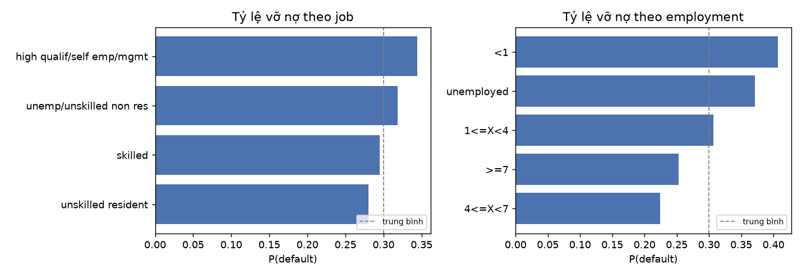
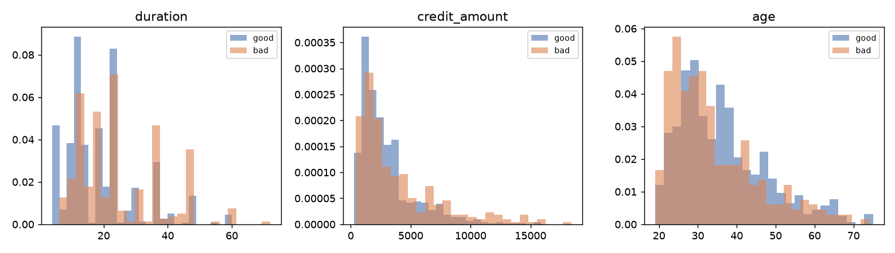

# EDA nhanh – German Credit (OpenML `credit-g`)

_Sinh tự động bởi `python -m src.data.eda`. Không sửa tay._

- Số dòng × cột: **1000 × 20** (+ nhãn)
- Tỷ lệ vỡ nợ (`class == bad`): **30.0%**
- Giá trị thiếu: **0**
- Biến số (7): duration, credit_amount, installment_commitment, residence_since, age, existing_credits, num_dependents
- Biến phân loại (13): checking_status, credit_history, purpose, savings_status, employment, personal_status, other_parties, property_magnitude, other_payment_plans, housing, job, own_telephone, foreign_worker

## Độ liên hệ với nhãn vỡ nợ (Cramér's V, biến số chia 5 quantile)

| feature                | type        |   n_levels |   cramers_v |
|:-----------------------|:------------|-----------:|------------:|
| checking_status        | categorical |          4 |       0.348 |
| credit_history         | categorical |          5 |       0.24  |
| duration               | numeric     |         33 |       0.205 |
| savings_status         | categorical |          5 |       0.179 |
| purpose                | categorical |         10 |       0.156 |
| property_magnitude     | categorical |          4 |       0.144 |
| credit_amount          | numeric     |        921 |       0.129 |
| housing                | categorical |          3 |       0.127 |
| employment             | categorical |          5 |       0.12  |
| age                    | numeric     |         53 |       0.104 |
| other_payment_plans    | categorical |          3 |       0.104 |
| personal_status        | categorical |          4 |       0.081 |
| foreign_worker         | categorical |          2 |       0.076 |
| other_parties          | categorical |          3 |       0.068 |
| installment_commitment | numeric     |          4 |       0.058 |
| own_telephone          | categorical |          2 |       0.018 |
| residence_since        | numeric     |          4 |       0     |
| existing_credits       | numeric     |          4 |       0     |
| num_dependents         | numeric     |          2 |       0     |
| job                    | categorical |          4 |       0     |

## Thống kê biến số

|                        |   count |    mean |     std |   min |    25% |    50% |     75% |   max |
|:-----------------------|--------:|--------:|--------:|------:|-------:|-------:|--------:|------:|
| duration               |    1000 |   20.9  |   12.06 |     4 |   12   |   18   |   24    |    72 |
| credit_amount          |    1000 | 3271.26 | 2822.74 |   250 | 1365.5 | 2319.5 | 3972.25 | 18424 |
| installment_commitment |    1000 |    2.97 |    1.12 |     1 |    2   |    3   |    4    |     4 |
| residence_since        |    1000 |    2.84 |    1.1  |     1 |    2   |    3   |    4    |     4 |
| age                    |    1000 |   35.55 |   11.38 |    19 |   27   |   33   |   42    |    75 |
| existing_credits       |    1000 |    1.41 |    0.58 |     1 |    1   |    1   |    2    |     4 |
| num_dependents         |    1000 |    1.16 |    0.36 |     1 |    1   |    1   |    1    |     2 |

## Tỷ lệ vỡ nợ theo `job`

| job                       |   n |   default_rate |
|:--------------------------|----:|---------------:|
| unskilled resident        | 200 |          0.28  |
| skilled                   | 630 |          0.295 |
| unemp/unskilled non res   |  22 |          0.318 |
| high qualif/self emp/mgmt | 148 |          0.345 |

## Tỷ lệ vỡ nợ theo `employment`

| employment   |   n |   default_rate |
|:-------------|----:|---------------:|
| 4<=X<7       | 174 |          0.224 |
| >=7          | 253 |          0.253 |
| 1<=X<4       | 339 |          0.307 |
| unemployed   |  62 |          0.371 |
| <1           | 172 |          0.407 |

## Tỷ lệ vỡ nợ theo `purpose`

| purpose             |   n |   default_rate |
|:--------------------|----:|---------------:|
| retraining          |   9 |          0.111 |
| used car            | 103 |          0.165 |
| radio/tv            | 280 |          0.221 |
| furniture/equipment | 181 |          0.32  |
| domestic appliance  |  12 |          0.333 |
| business            |  97 |          0.351 |
| repairs             |  22 |          0.364 |
| new car             | 234 |          0.38  |
| other               |  12 |          0.417 |
| education           |  50 |          0.44  |

## Tỷ lệ vỡ nợ theo `credit_history`

| credit_history                 |   n |   default_rate |
|:-------------------------------|----:|---------------:|
| critical/other existing credit | 293 |          0.171 |
| delayed previously             |  88 |          0.318 |
| existing paid                  | 530 |          0.319 |
| all paid                       |  49 |          0.571 |
| no credits/all paid            |  40 |          0.625 |

## Tỷ lệ vỡ nợ theo `checking_status`

| checking_status   |   n |   default_rate |
|:------------------|----:|---------------:|
| no checking       | 394 |          0.117 |
| >=200             |  63 |          0.222 |
| 0<=X<200          | 269 |          0.39  |
| <0                | 274 |          0.493 |

## Tỷ lệ vỡ nợ theo `savings_status`

| savings_status   |   n |   default_rate |
|:-----------------|----:|---------------:|
| >=1000           |  48 |          0.125 |
| 500<=X<1000      |  63 |          0.175 |
| no known savings | 183 |          0.175 |
| 100<=X<500       | 103 |          0.33  |
| <100             | 603 |          0.36  |

## Hình

