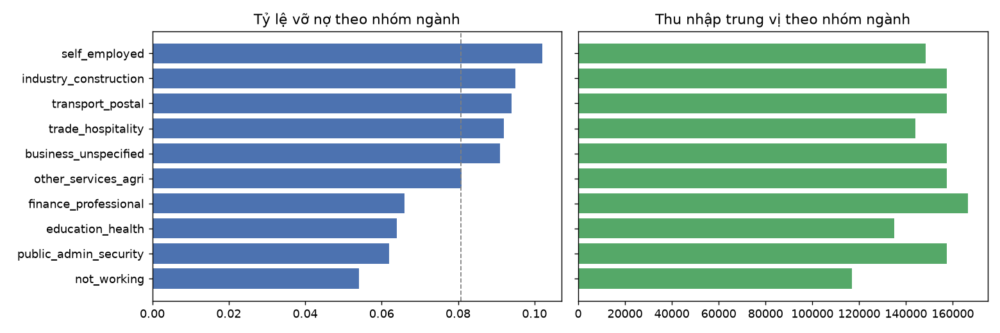

# EDA – Home Credit `application_train.csv`

_Sinh tự động bởi `python -m src.data.eda_home_credit`. Không sửa tay._

- Số dòng: **307,511**; tỷ lệ vỡ nợ (`TARGET=1`): **8.07%**
- Đặc trưng đã tạo trong `src/data/home_credit.py` (không dùng giới tính/hôn nhân).

## Liên hệ với nhãn (Cramér's V; biến số chia 5 quantile, thiếu = 1 nhóm riêng)

| feature               |   missing_% |   n_unique |   cramers_v |
|:----------------------|------------:|-----------:|------------:|
| ext_score_mean        |         0.1 |     300347 |       0.213 |
| years_employed        |        18   |      12573 |       0.088 |
| age_years             |         0   |      17460 |       0.077 |
| occupation_group      |         0   |          5 |       0.076 |
| goods_to_credit       |         0.1 |       3066 |       0.075 |
| sector                |         0   |         10 |       0.062 |
| region_rating         |         0   |          3 |       0.061 |
| education             |         0   |          3 |       0.057 |
| credit_term_months    |         0   |      39539 |       0.057 |
| bureau_inquiries_year |        13.5 |         25 |       0.037 |
| contract_type         |         0   |          2 |       0.031 |
| income                |         0   |       2548 |       0.025 |
| credit_to_income      |         0   |      48697 |       0.024 |
| own_car               |         0   |          2 |       0.022 |
| annuity_to_income     |         0   |      88811 |       0.019 |
| family_size           |         0   |         17 |       0.015 |
| n_children            |         0   |         15 |       0.01  |
| social_circle_def30   |         0.3 |         10 |       0.009 |
| own_realty            |         0   |          2 |       0.006 |

## Theo nhóm ngành (`sector`)

| sector                |     n |   default_rate |   median_income |   median_years_employed |   median_age |
|:----------------------|------:|---------------:|----------------:|------------------------:|-------------:|
| not_working           | 55374 |          0.054 |          117000 |                 nan     |       60.372 |
| public_admin_security | 17913 |          0.062 |          157500 |                   6.741 |       39.499 |
| education_health      | 28293 |          0.064 |          135000 |                   7.031 |       42.393 |
| finance_professional  |  5128 |          0.066 |          166500 |                   3.351 |       34.575 |
| other_services_agri   | 27641 |          0.081 |          157500 |                   4.879 |       42.305 |
| business_unspecified  | 84529 |          0.091 |          157500 |                   3.953 |       39.124 |
| trade_hospitality     | 17092 |          0.092 |          144000 |                   3.222 |       37.696 |
| transport_postal      | 11147 |          0.094 |          157500 |                   4.939 |       40.605 |
| industry_construction | 21982 |          0.095 |          157500 |                   4.439 |       40.19  |
| self_employed         | 38412 |          0.102 |          148500 |                   4.312 |       39.376 |

## Theo nhóm nghề (`occupation_group`, ISCO-08)

| occupation_group     |     n |   default_rate |   median_income |
|:---------------------|------:|---------------:|----------------:|
| manager_professional | 43090 |          0.059 |          189000 |
| technician_clerical  | 38726 |          0.064 |          148500 |
| unknown              | 96391 |          0.065 |          135000 |
| service_sales        | 48769 |          0.098 |          135000 |
| manual_elementary    | 80535 |          0.109 |          157500 |

## Tỷ lệ vỡ nợ theo quintile của biến số (kiểm tra hướng tác động/đơn điệu)

|                       |    Q1 |    Q2 |    Q3 |    Q4 |      Q5 |
|:----------------------|------:|------:|------:|------:|--------:|
| income                | 0.082 | 0.086 | 0.087 | 0.081 |   0.065 |
| credit_to_income      | 0.073 | 0.086 | 0.089 | 0.083 |   0.073 |
| annuity_to_income     | 0.072 | 0.078 | 0.081 | 0.087 |   0.085 |
| credit_term_months    | 0.081 | 0.099 | 0.097 | 0.062 |   0.065 |
| age_years             | 0.113 | 0.093 | 0.078 | 0.067 |   0.052 |
| years_employed        | 0.112 | 0.107 | 0.091 | 0.071 |   0.052 |
| ext_score_mean        | 0.187 | 0.093 | 0.059 | 0.039 |   0.025 |
| bureau_inquiries_year | 0.072 | 0.081 | 0.08  | 0.086 | nan     |

## Quantile biến số

|                       |      0.01 |       0.2 |        0.4 |        0.5 |        0.6 |        0.8 |       0.99 |
|:----------------------|----------:|----------:|-----------:|-----------:|-----------:|-----------:|-----------:|
| income                | 45000     | 99000     | 135000     | 147150     | 162000     | 225000     | 472500     |
| credit_to_income      |     0.595 |     1.818 |      2.764 |      3.265 |      3.906 |      5.769 |     13.027 |
| annuity_to_income     |     0.039 |     0.104 |      0.144 |      0.163 |      0.186 |      0.247 |      0.483 |
| credit_term_months    |     8.71  |    14.63  |     19.536 |     20     |     22.01  |     30.143 |     37.794 |
| age_years             |    22.623 |    32.016 |     39.469 |     43.121 |     47.146 |     56.055 |     66.856 |
| years_employed        |     0.304 |     1.689 |      3.422 |      4.512 |      5.914 |     10.064 |     31.043 |
| ext_score_mean        |     0.11  |     0.384 |      0.484 |      0.525 |      0.564 |      0.644 |      0.773 |
| bureau_inquiries_year |     0     |     0     |      1     |      1     |      2     |      3     |      8     |

