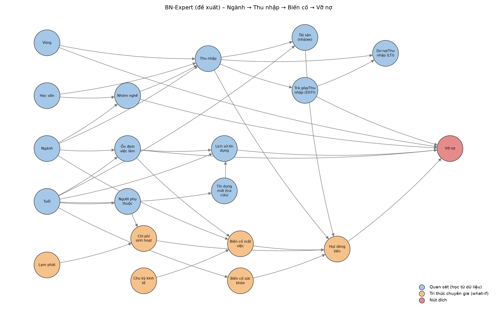
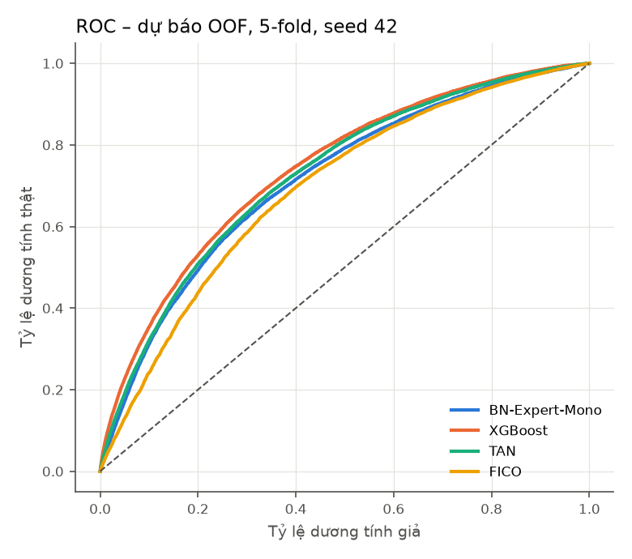
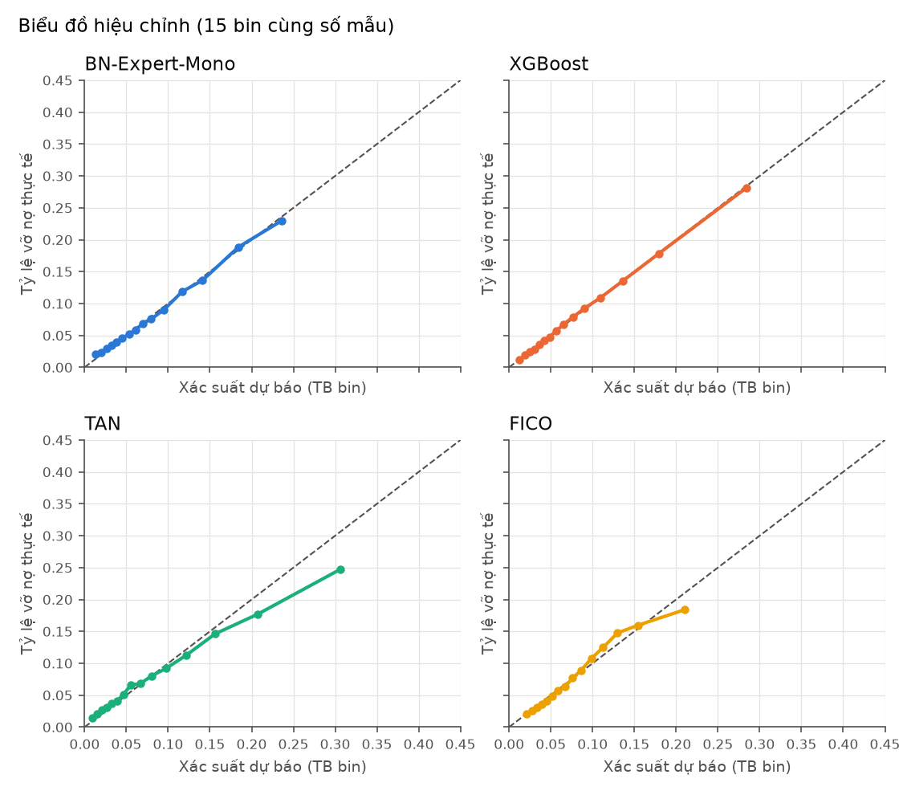
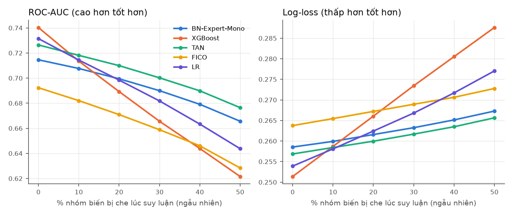
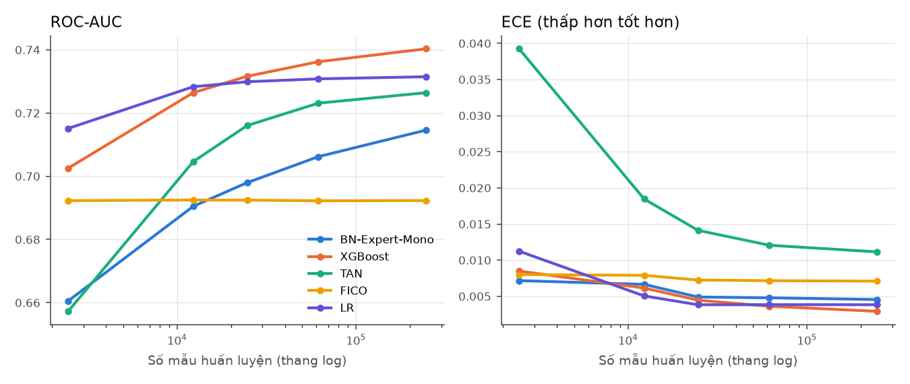
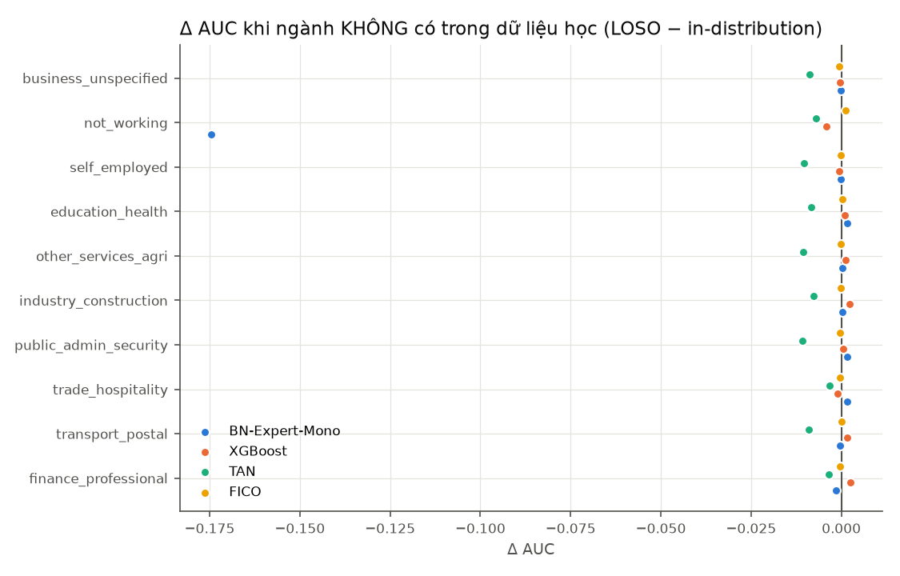
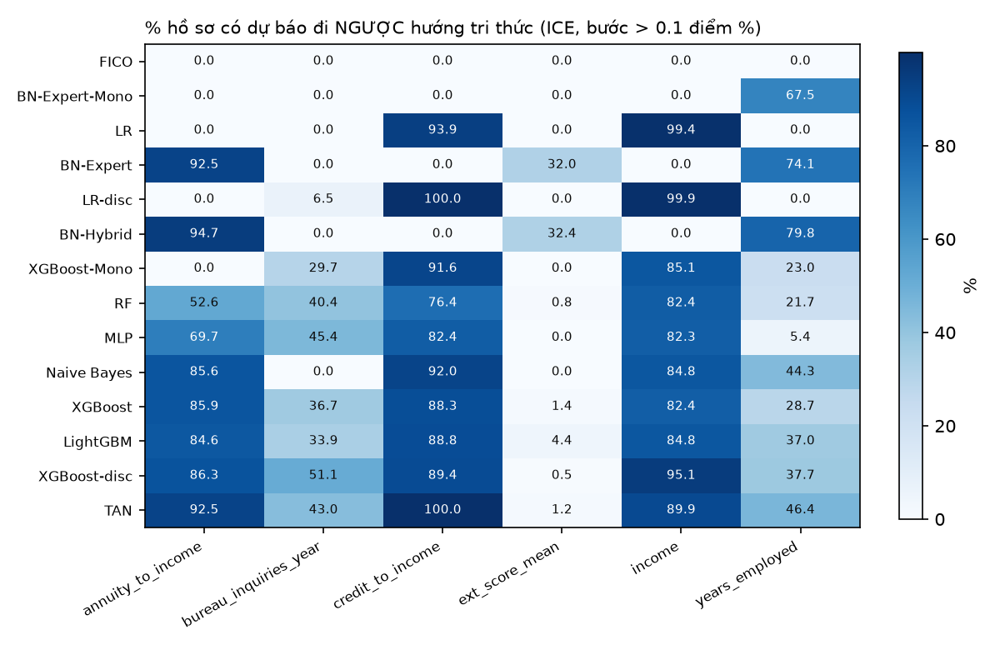
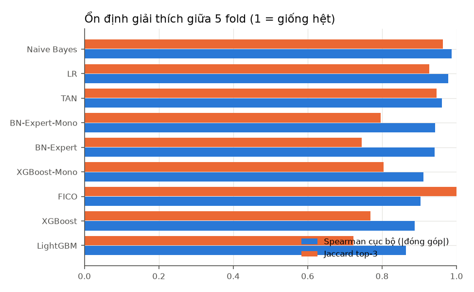
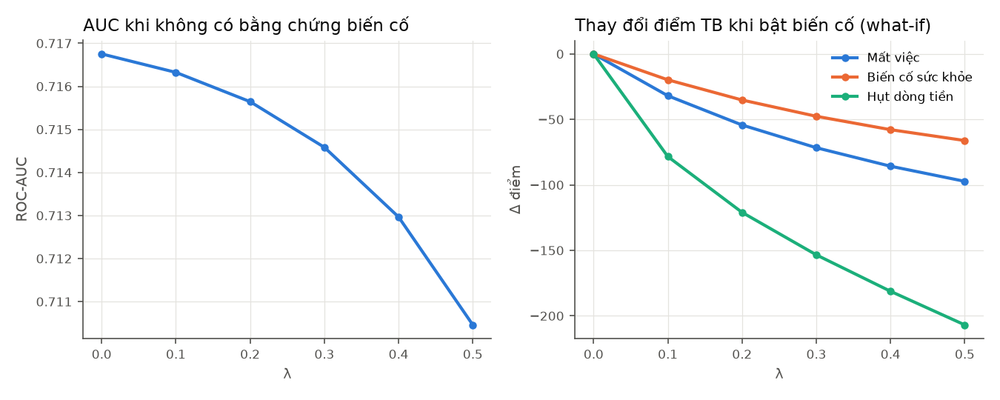

<!-- SINH TỰ ĐỘNG bởi `python -m src.cli report` từ reports/chapters/*.md + reports/results/. Sửa văn bản trong reports/chapters/, KHÔNG sửa file này. -->

# Dự báo khả năng tài chính cá nhân theo ngành nghề bằng Mạng Bayes

**Đồ án cuối kỳ – Chuyên đề nghiên cứu và ứng dụng về Công nghệ tri thức (Project 6)**
Nhóm: Mạnh · Nam · Khôi · Phúc — Ngày nộp & báo cáo: 02/12/2026

> Quy ước của báo cáo: mọi con số, bảng và hình đều được sinh bởi script trong repo (`python -m src.cli eval`,
> `python -m src.cli report`). Chỗ nào là giả định của nhóm được ghi rõ **giả định**. Mã nguồn, cấu hình và
> kết quả thô nằm trong repo (`src/`, `configs/`, `experiments/`).

## Mục lục
1. Giới thiệu và khác biệt so với đề tài FICO rule-based
2. Thu thập và biểu diễn tri thức
3. Mô hình Mạng Bayes và thuật giải suy luận
4. Thực nghiệm: Mạng Bayes so với Black-box ML
5. Hệ thống demo và LLM diễn giải
6. Kết luận, hạn chế và hướng phát triển
7. Tài liệu tham khảo


## 1. Giới thiệu

### 1.1. Bài toán
Đánh giá khả năng tài chính cá nhân (rủi ro vỡ nợ) không chỉ phụ thuộc vào các con số hiện tại của người vay mà
còn vào **bối cảnh nghề nghiệp** – ngành nghề quyết định mức và độ ổn định thu nhập – và vào **biến cố** có thể
xảy ra (mất việc, chi phí y tế, lạm phát). Đề tài mô hình hóa chuỗi nhân quả

`Ngành → Thu nhập → Biến cố → Khả năng vỡ nợ`

bằng **Mạng Bayes (BN)** để: (i) suy luận xuôi – dự báo xác suất vỡ nợ và quy đổi sang điểm 300–850;
(ii) suy luận ngược – từ một mục tiêu (điểm tín dụng, sở hữu tài sản) suy ra điều kiện cần về thu nhập/chi tiêu;
(iii) dùng LLM diễn giải kết quả thành lời khuyên tiếng Việt; (iv) kiểm chứng thực nghiệm độ đúng và độ tin cậy
của BN so với các mô hình học máy "hộp đen".

### 1.2. Dữ liệu
- **Home Credit Default Risk** (`application_train.csv`, 307.511 hồ sơ, tỷ lệ vỡ nợ 8,07%) – dữ liệu chính, có
  ngành (58 loại tổ chức), nghề, thu nhập, khoản vay, thâm niên, điểm tín dụng ngoài.
- **German Credit** (1.000 hồ sơ) – bộ phụ cho thí nghiệm dữ liệu ít.
- **Tri thức vĩ mô Việt Nam**: World Bank (lạm phát, thất nghiệp, tăng trưởng GDP), WHO (chi y tế thảm họa theo
  tuổi), GSO – Khảo sát mức sống dân cư 2024 (thu nhập, chi tiêu theo ngũ phân vị).

### 1.3. Khác biệt so với đề tài trước (FICO rule-based)
Đề tài trước xây hệ thống chấm điểm giả lập theo luật FICO cơ bản (5 nhóm yếu tố với trọng số cố định). Nhóm
không còn mã nguồn cũ nên đã **tái hiện tối giản** hệ luật này (`configs/fico.yaml`, `src/baselines/fico.py`)
làm mốc so sánh trực tiếp.

| Khía cạnh | FICO rule-based (đề tài cũ) | Mạng Bayes (đề tài này) |
|---|---|---|
| Biểu diễn tri thức | Luật + trọng số cố định 35/30/15/10/10 | Đồ thị nhân quả 20 nút, 35 cạnh có lý do; CPT học từ dữ liệu + tri thức vĩ mô |
| Đầu ra | Điểm tất định | Xác suất vỡ nợ (có độ bất định) → điểm 300–850 |
| Ngành nghề | Không dùng | Ngành → Nghề → Thu nhập, Ổn định việc làm, Rủi ro mất việc |
| Biến cố | Không mô hình hóa | Nút tri thức: mất việc, sức khỏe, lạm phát, chu kỳ kinh tế, chi phí sinh hoạt → hụt dòng tiền |
| Thiếu thông tin | Gán điểm trung tính | Lấy biên chính xác theo xác suất (không cần điền giá trị) |
| Suy luận ngược | Không | Hậu nghiệm ngược, MAP, phản thực do() có chi phí |
| Học từ dữ liệu | Không (chỉ hiệu chỉnh Platt để so sánh) | Có (CPT m-estimate; ràng buộc đơn điệu chuyên gia) |
| Giải thích | Điểm thành phần | Đóng góp từng yếu tố (suy luận chính xác) + đồ thị nhân quả + LLM |
| Kiểm chứng | Không có | 9 thí nghiệm so với 8 mô hình ML và 4 biến thể Bayes |

Kết quả so sánh định lượng với FICO nằm ở Chương 4 (BN-Expert-Mono hơn FICO 0.022 AUC).

### 1.4. Đóng góp
1. BN-Expert hai lớp: lớp dữ liệu (CPT học) + lớp tri thức (CPT sinh tự động từ nguồn có trích dẫn), nối bằng
   **calibrated noisy-OR** để lớp tri thức phục vụ what-if mà gần như không làm sai phần đã học từ dữ liệu (xem độ nhạy λ, mục 4.10).
2. Biến thể **BN-Expert-Mono** chiếu CPT lên ràng buộc đơn điệu chuyên gia (isotonic/POCS) – không bao giờ cho
   lời khuyên ngược tri thức ở các biến được ràng buộc.
3. Bộ suy luận chính xác theo lô (khớp pgmpy tới 1e-8), đủ nhanh cho hàng triệu truy vấn trong thực nghiệm.
4. Suy luận ngược bằng phản thực do() có chi phí trên 7 đòn bẩy người dùng điều khiển được.
5. Báo cáo thực nghiệm trung thực trên 9 tiêu chí (phân biệt, hiệu chỉnh, kiểm định, thiếu thông tin, dữ liệu ít,
   dịch chuyển theo ngành, nhất quán tri thức, ổn định giải thích, chi phí).


## 2. Thu thập và biểu diễn tri thức


### 2.1. Nguồn tri thức

| Tri thức | Nguồn | File | Dùng cho |
|---|---|---|---|
| Ngành → 10 nhóm | ISIC Rev.4 (UN), cách gộp của GSO | `knowledge_base/sector_mapping.csv` | nút Ngành |
| Nghề → 5 nhóm | ISCO-08 (ILO) | `knowledge_base/occupation_mapping.csv` | nút Nhóm nghề |
| Lạm phát, thất nghiệp, GDP VN 2000–2024 | World Bank WDI API | `knowledge_base/macro_vn_worldbank.csv` | CPT Lạm phát, Chu kỳ KT, Mất việc |
| Chi y tế thảm họa theo tuổi | WHO GHO (SDG 3.8.2) | `knowledge_base/health_catastrophic_vn_who.csv` | CPT Biến cố sức khỏe |
| Thu nhập & chi tiêu theo ngũ phân vị 2024 | GSO – KSMS 2024 (Biểu 4, 11) | `knowledge_base/vn_income_spending_quintiles_2024.csv` | đệm tài chính; quy đổi VND trong demo |
| Ngưỡng DSTI/LTI | FCA (UK), HCSF (Pháp), Eesti Pank | `knowledge_base/debt_threshold_sources.csv` | ngưỡng rời rạc hóa |
| Trọng số FICO | myFICO | `configs/fico.yaml` | baseline FICO |

### 2.2. Biểu diễn tri thức trong mô hình



*Hình: DAG BN-Expert: 14 nút dữ liệu (xanh) và 6 nút tri thức (cam)*

Tham số lớp tri thức (sinh tự động từ nguồn):

#### Tham số lớp tri thức của BN-Expert (sinh tự động bởi `python -m src.cli train`)

| Tham số | Giá trị | Nguồn |
|---|---|---|
| P(inflation) [low, moderate, high] | [0.547, 0.208, 0.245] | World Bank FP.CPI.TOTL.ZG, VN 2000–2024, ngưỡng 4%/8% |
| P(econ_cycle) [normal, downturn] | [0.865, 0.135] | World Bank NY.GDP.MKTP.KD.ZG, VN 2000–2024, ngưỡng 5% (giả định) |
| unemployment base (normal years) | 0.0175 | World Bank SL.UEM.TOTL.ZS, TB các năm 'normal' |
| unemployment multiplier downturn/normal | 1.165 | World Bank, TB downturn / normal |
| sector churn multiplier (proxy) | {"business_unspecified": 1.156, "education_health": 0.597, "finance_professional": 1.444, "industry_construction": 1.135, "other_services_agri": 0.943, "public_admin_security": 0.628, "self_employed": 0.831, "trade_hospitality": 1.525, "transport_postal": 0.884} | Proxy từ Home Credit: tỷ lệ thâm niên < 1 năm theo ngành |
| health shock P(<60), P(>=60) – WHO 2018 | [0.0883, 0.13369999999999999] | WHO GHO SDG 3.8.2 (chi y tế > 10%), VN 2018, theo tuổi |
| income buffer by quintile – GSO 2024 | {"Q1": 1.0, "Q2": 0.769, "Q3": 0.642, "Q4": 0.569, "Q5": 0.418} | GSO KSMS 2024 Biểu 4 & 11: (chi tiêu/thu nhập) nhóm Qk / Q1 |

Tham số GIẢ ĐỊNH (configs/bn_expert_cpt.yaml):

- tenure multiplier: {'<1': 2.0, '1-3': 1.3, '3-7': 1.0, '>=7': 0.6, 'not_working': 0.0}
- horizon multiplier: 2.0
- living_cost: base [0.35, 0.5, 0.15], shift 0.45
- cashflow_shock: leak 0.01, inhibitors {'job_loss': {'yes': 0.6}, 'health_shock': {'yes': 0.35}, 'living_cost': {'high': 0.15, 'normal': 0.03}}, asset buffer {'none': 1.0, 'car': 0.9, 'realty': 0.8, 'both': 0.7}
- default_link λ = 0.3


### 2.3. Kiểm tra tri thức bằng dữ liệu

### 2.4. Hạn chế của tri thức


## 3. Mô hình Mạng Bayes và thuật giải suy luận

### 3.1. Biến và rời rạc hóa
Mười ba biến đầu vào được tạo từ Home Credit (`src/data/home_credit.py`) và rời rạc hóa theo
`configs/discretize.yaml`:
- **Ngưỡng nghiệp vụ cố định**: tuổi (30/40/50/60), thâm niên (1/3/7 năm; *không đi làm* là một trạng thái riêng),
  DSTI = trả góp/thu nhập (10/20/30/40%), LTI = dư nợ/thu nhập năm (1,5/3/4,5/7 lần), số con, số lần tra cứu.
- **Ngũ phân vị**: thu nhập và điểm tín dụng ngoài (đơn vị không được công bố). Ngưỡng **được học lại trên tập
  train của từng fold** để không rò rỉ thông tin.
- **Nhóm theo chuẩn**: ngành (10 nhóm ISIC Rev.4), nghề (5 nhóm ISCO-08), học vấn (3 mức), vùng (1–3).
- Không dùng thuộc tính nhạy cảm (giới tính, hôn nhân).

### 3.2. Cấu trúc BN-Expert (hai lớp)


*Hình: DAG BN-Expert (nhóm duyệt 22/11/2026)*

- **Lớp dữ liệu** (14 nút): mỗi cạnh có lý do và bằng chứng (`configs/bn_expert.yaml`). Nút `default` có 5 cha
  dữ liệu: lịch sử tín dụng, thâm niên, nhóm nghề, DSTI, vùng.
- **Lớp tri thức** (6 nút): Lạm phát, Chu kỳ kinh tế, Mất việc, Biến cố sức khỏe, Chi phí sinh hoạt, Hụt dòng
  tiền. Các nút này không có trong dữ liệu; CPT được **sinh tự động** từ `knowledge_base/` (`src/bn/expert_cpt.py`):
  - P(lạm phát) và P(suy giảm) là tần suất năm của Việt Nam 2000–2024.
  - P(mất việc) = tỷ lệ thất nghiệp nền × hệ số chu kỳ × hệ số ngành × hệ số thâm niên × kỳ hạn.
  - P(biến cố sức khỏe | tuổi) lấy theo WHO.
  - Hụt dòng tiền là noisy-OR có leak, nhân với hệ số đệm theo thu nhập (GSO) và theo tài sản.

  Các hệ số không có nguồn được ghi rõ là **giả định** (Chương 2).

### 3.3. Học tham số
CPT của nút dữ liệu được ước lượng bằng **m-estimate** với prior là phân phối biên:
θ_ijk = (N_ijk + m·P(k)) / (N_ij + m), m = 10.
- m được chọn trên một tập validation tách ra **từ train**.
- Lý do bỏ BDeu: BDeu chuẩn gán P(vỡ nợ) = 0,5 cho tổ hợp cha chưa gặp, trong khi tỷ lệ nền chỉ là 8%. m-estimate
  lùi về tỷ lệ nền.

### 3.4. Nối lớp tri thức vào nút đích: calibrated noisy-OR
Gọi P_data(D | pa) là CPT học từ dữ liệu và π = P(hụt dòng tiền) tiên nghiệm của quần thể. Khi đó:

- P(D=1 | pa, shock=no) = p0
- P(D=1 | pa, shock=yes) = 1 − (1 − p0)(1 − λ)
- p0 = (P_data − λπ) / (1 − λπ)

Cách nối này cho **đúng** P_data khi không có bằng chứng về biến cố, trừ các ô có P_data < λπ, nơi p0 phải bị cắt
ở 1e-4. Vì vậy lớp tri thức gần như không làm thay đổi độ chính xác đã học (AUC 0.7168 khi λ = 0 so
với 0.7146 khi λ = 0,3), và chủ yếu hoạt động trong các phân tích what-if. λ = 0,3 là **giả định**;
độ nhạy theo λ được phân tích ở mục 4.10.

### 3.5. BN-Expert-Mono: ràng buộc đơn điệu chuyên gia
Theo tri thức chuyên gia, DSTI tăng thì rủi ro không được giảm, và lịch sử tín dụng tốt hơn thì rủi ro không được
tăng. Dữ liệu lại cho thấy DSTI có liên hệ yếu và không đơn điệu với vỡ nợ (nhiều khả năng do thiên lệch chọn mẫu:
ngân hàng chỉ duyệt DSTI cao cho người an toàn).
- **Cách làm:** chiếu P_data(D=1 | pa) lên giao của các ràng buộc đơn điệu. Mỗi bước là một isotonic regression có
  trọng số theo số mẫu N_ij, lặp luân phiên (POCS). Sau đó một bước đóng cummax/cummin bảo đảm thỏa *chính xác*
  mọi ràng buộc (có kiểm tra bằng test).
- **Vì sao chọn làm mô hình chính:** đây là mô hình chính của demo, vì nó không bao giờ khuyên "tăng nợ để giảm
  rủi ro".

### 3.6. Suy luận xuôi chính xác theo lô
- **Thuật giải:** các truy vấn P(D | bằng chứng) được gom theo *mẫu biến quan sát*. Với mỗi mẫu, bộ suy luận
  bỏ các nút cằn (barren) không liên quan. Lát CPT của biến quan sát được lấy theo từng dòng (gather), còn biến ẩn
  được cộng bằng `numpy.einsum` với thứ tự khử tham lam. Thuật giải này là suy luận chính xác (tương đương
  variable elimination), không phải xấp xỉ.
- **Kiểm chứng:** kết quả khớp `pgmpy.VariableElimination` tới 1e-8 (`tests/test_bn.py`). Tốc độ đạt khoảng
  61.000 hồ sơ trong 0,2 giây, đủ cho các thí nghiệm thiếu thông tin và ICE.
- **Bằng chứng bất khả:** khi bằng chứng không thể xảy ra (ví dụ "mất việc" với người không đi làm), P(e) = 0 nên
  kết quả trả về NaN tường minh. Demo chặn trường hợp này.

### 3.7. Quy đổi điểm 300–850
Điểm = A + B·ln((1 − p)/p), cắt về đoạn [300, 850]. Hai điểm neo là p = 50% → 400 điểm và p = 0,5% → 800 điểm,
tức B = 400/ln 199 ≈ 75,6 (≈ 52 điểm mỗi lần odds tốt gấp đôi). Các mức rủi ro: ≥ 740 Rất tốt; ≥ 670 Tốt;
≥ 580 Trung bình; ≥ 500 Kém; còn lại Rất kém.

### 3.8. Suy luận ngược
1. **Hậu nghiệm ngược.** So sánh P(đòn bẩy | hồ sơ) với P(đòn bẩy | hồ sơ, mục tiêu đạt), trong đó mục tiêu
   là không vỡ nợ hoặc sở hữu nhà/xe. Hệ số nâng (lift) cho biết mức nào là *điều kiện cần* thường gặp ở những
   người đạt mục tiêu.
2. **MAP.** argmax của tổ hợp đòn bẩy, tính bằng pgmpy.
3. **Phản thực do() có chi phí.**
   - Đòn bẩy gồm 7 yếu tố người dùng điều khiển được: thu nhập ↑, DSTI ↓, LTI ↓, chi phí sinh hoạt ↓, tra cứu
     tín dụng ↓, và 2 đòn bẩy dài hạn là lịch sử tín dụng ↑ và thâm niên ↑.
   - Mỗi thay đổi là một can thiệp do(): cắt các cạnh đi vào nút (graph surgery), để không suy diễn ngược sai
     chiều nhân quả.
   - Thuật toán duyệt toàn bộ lưới tổ hợp (vài nghìn tổ hợp, suy luận theo lô) và trả về các kế hoạch không bị
     trội (chi phí thấp nhất, P(vỡ nợ) thấp nhất) đạt điểm mục tiêu.
   - Chi phí mỗi bậc là **giả định** (`configs/backward.yaml`).
   - Phát hiện trung thực: chỉ thay đổi thu nhập và chi tiêu thường không đủ để tăng nhiều điểm. Lịch sử tín dụng
     chi phối, nên các đòn bẩy dài hạn được bổ sung.

### 3.9. Các mô hình so sánh
| Họ | Mô hình | Ghi chú |
|---|---|---|
| Luật | FICO | Tái hiện đề tài cũ; chỉ hiệu chỉnh Platt (điểm → xác suất) |
| Bayes | BN-Expert, BN-Expert-Mono | Mô hình đề xuất |
| Bayes | Naive Bayes, TAN, BN-Learned (Hill-Climb + BIC), BN-Hybrid (Hill-Climb + cạnh bắt buộc + thứ tự tầng) | Cùng nút và cùng ước lượng tham số; chỉ khác cấu trúc |
| ML hộp đen | LR, XGBoost, LightGBM, RF, MLP trên đặc trưng liên tục; LR-disc, XGBoost-disc trên đúng trạng thái BN; XGBoost-Mono có cùng ràng buộc đơn điệu với BN-Expert-Mono | Cùng 13 nhóm biến (công bằng thông tin); XGBoost tinh chỉnh bằng Optuna (25 trial, chỉ trên train) |


## 4. Thực nghiệm: Mạng Bayes so với Black-box ML


### 4.1. Thiết lập
- Dữ liệu: Home Credit 307.511 hồ sơ, cùng 13 nhóm biến cho mọi mô hình. Danh sách 15 mô hình ở mục 3.9.
- Đánh giá: stratified 5-fold × 3 seed (15 lần). Mọi bước học, kể cả ngưỡng rời rạc hóa và tinh chỉnh, chỉ dùng
  train của fold.
- Chi tiết thiết kế từng thí nghiệm: `docs/guide/05_thuc_nghiem.md`.
- Toàn bộ thực nghiệm chạy khoảng 100 phút trên CPU 16 luồng (`python -m src.cli eval`).

### 4.2. Phân biệt và hiệu chỉnh (thí nghiệm 1, 2)
<!-- sinh tự động bởi `python -m src.cli eval tables` – không sửa tay -->
**Bảng 1 – Phân biệt & hiệu chỉnh (thí nghiệm 1, 2)**

| Mô hình        | Họ   | Đầu vào   | ROC-AUC         | PR-AUC          |   Gini |    KS | Brier             | Log-loss        | ECE             |   Số lần |
|:---------------|:-----|:----------|:----------------|:----------------|-------:|------:|:------------------|:----------------|:----------------|---------:|
| XGBoost        | ml   | cont      | 0.7404 ± 0.0039 | 0.2172 ± 0.0051 |  0.481 | 0.357 | 0.06899 ± 0.00022 | 0.2513 ± 0.0010 | 0.0031 ± 0.0008 |       15 |
| LightGBM       | ml   | cont      | 0.7392 ± 0.0039 | 0.2161 ± 0.0054 |  0.478 | 0.355 | 0.06906 ± 0.00023 | 0.2517 ± 0.0010 | 0.0031 ± 0.0009 |       15 |
| XGBoost-Mono   | ml   | cont      | 0.7387 ± 0.0042 | 0.2151 ± 0.0049 |  0.477 | 0.354 | 0.06909 ± 0.00023 | 0.2518 ± 0.0011 | 0.0035 ± 0.0011 |       15 |
| RF             | ml   | cont      | 0.7333 ± 0.0041 | 0.2094 ± 0.0040 |  0.467 | 0.348 | 0.06948 ± 0.00016 | 0.2537 ± 0.0008 | 0.0074 ± 0.0011 |       15 |
| MLP            | ml   | cont      | 0.7333 ± 0.0039 | 0.2098 ± 0.0046 |  0.467 | 0.346 | 0.06938 ± 0.00021 | 0.2534 ± 0.0010 | 0.0050 ± 0.0022 |       15 |
| LR             | ml   | cont      | 0.7314 ± 0.0043 | 0.2050 ± 0.0039 |  0.463 | 0.345 | 0.06954 ± 0.00021 | 0.2539 ± 0.0010 | 0.0038 ± 0.0009 |       15 |
| XGBoost-disc   | ml   | disc      | 0.7308 ± 0.0041 | 0.1925 ± 0.0043 |  0.462 | 0.346 | 0.06990 ± 0.00020 | 0.2547 ± 0.0010 | 0.0035 ± 0.0009 |       15 |
| LR-disc        | ml   | disc      | 0.7272 ± 0.0042 | 0.1882 ± 0.0037 |  0.454 | 0.342 | 0.07005 ± 0.00019 | 0.2556 ± 0.0010 | 0.0033 ± 0.0006 |       15 |
| TAN            | bn   | disc      | 0.7265 ± 0.0038 | 0.1896 ± 0.0039 |  0.453 | 0.338 | 0.07040 ± 0.00024 | 0.2568 ± 0.0011 | 0.0111 ± 0.0013 |       15 |
| BN-Expert-Mono | bn   | disc      | 0.7146 ± 0.0043 | 0.1767 ± 0.0039 |  0.429 | 0.326 | 0.07054 ± 0.00020 | 0.2586 ± 0.0010 | 0.0047 ± 0.0008 |       15 |
| BN-Hybrid      | bn   | disc      | 0.7119 ± 0.0047 | 0.1747 ± 0.0039 |  0.424 | 0.322 | 0.07065 ± 0.00020 | 0.2591 ± 0.0011 | 0.0043 ± 0.0008 |       15 |
| BN-Expert      | bn   | disc      | 0.7107 ± 0.0046 | 0.1743 ± 0.0038 |  0.421 | 0.32  | 0.07069 ± 0.00020 | 0.2595 ± 0.0011 | 0.0050 ± 0.0010 |       15 |
| Naive Bayes    | bn   | disc      | 0.7085 ± 0.0042 | 0.1749 ± 0.0037 |  0.417 | 0.312 | 0.07494 ± 0.00046 | 0.2727 ± 0.0019 | 0.0370 ± 0.0016 |       15 |
| BN-Learned     | bn   | disc      | 0.7078 ± 0.0070 | 0.1589 ± 0.0049 |  0.416 | 0.325 | 0.07078 ± 0.00020 | 0.2592 ± 0.0012 | 0.0033 ± 0.0006 |       15 |
| FICO           | rule | disc      | 0.6923 ± 0.0041 | 0.1508 ± 0.0032 |  0.385 | 0.299 | 0.07171 ± 0.00015 | 0.2637 ± 0.0008 | 0.0069 ± 0.0008 |       15 |

_Stratified 5-fold × 3 seed (mean ± std trên các fold), Home Credit 307.511 hồ sơ, tỷ lệ vỡ nợ 8,07%. ECE: 15 bin cùng số mẫu._




*Hình: ROC của 4 mô hình đại diện (dự báo OOF, seed 42)*



*Hình: Biểu đồ hiệu chỉnh*

**Kết quả.**
- **ML hộp đen phân biệt tốt nhất.** XGBoost đạt AUC 0.740. BN-Expert-Mono đạt
  0.715, thấp hơn 0.026. Nhóm không chỉnh thí nghiệm để thu hẹp khoảng
  cách này.
- **BN-Expert-Mono hơn FICO rule-based 0.022 AUC.** FICO đạt 0.692. Học xác suất từ
  dữ liệu có lợi rõ so với luật cố định.
- **Ràng buộc tri thức không làm giảm độ chính xác.** BN-Expert-Mono (0.715) tốt hơn BN-Expert
  học thuần (0.711).
- **Trong họ Bayes:**
  - TAN phân biệt tốt nhất (0.726) nhưng hiệu chỉnh kém hơn: ECE 0.0111 so với
    0.0047 của BN-Expert-Mono.
  - Naive Bayes hiệu chỉnh kém nhất: ECE 0.0370.
  - BN-Learned (máy tự học cấu trúc) đạt 0.708. Như đã ghi ở G3, nó còn đảo chiều nhiều cạnh nhân
    quả.
- **Mất mát do rời rạc hóa và do cấu trúc.**
  - XGBoost trên đúng trạng thái BN (XGBoost-disc) đạt 0.731, LR-disc đạt 0.727.
  - Như vậy một phần khoảng cách đến từ rời rạc hóa. Phần còn lại đến từ cấu trúc thưa của BN-Expert: nút Vỡ nợ chỉ
    có 5 cha dữ liệu, các biến khác chỉ ảnh hưởng gián tiếp.
- **Hiệu chỉnh.** Mọi mô hình trừ Naive Bayes và TAN có ECE dưới 1%. BN-Expert-Mono có Log-loss
  0.2586, so với 0.2513 của XGBoost.


### 4.3. Ý nghĩa thống kê (thí nghiệm 3)
<!-- sinh tự động bởi `python -m src.cli eval tables` – không sửa tay -->
**Bảng 2 – Kiểm định ý nghĩa thống kê (thí nghiệm 3)**

| Tham chiếu     | So với         |   Δ AUC (ref − mô hình) |   DeLong p (Holm, max 3 seed) |   t-test hiệu chỉnh p (AUC) | Thắng AUC / số cặp fold   | Δ Log-loss [CI 95%]           | Δ ECE [CI 95%]             |
|:---------------|:---------------|------------------------:|------------------------------:|----------------------------:|:--------------------------|:------------------------------|:---------------------------|
| BN-Expert-Mono | FICO           |                  0.0222 |                      2e-121   |                     3.5e-11 | 15/15                     | -0.00521 [-0.00565, -0.00480] | -0.0033 [-0.0046, -0.0018] |
| BN-Expert-Mono | BN-Expert      |                  0.0034 |                      7.7e-27  |                     1.4e-06 | 15/15                     | -0.00081 [-0.00095, -0.00067] | -0.0005 [-0.0011, +0.0002] |
| BN-Expert-Mono | Naive Bayes    |                  0.006  |                      1.2e-09  |                     0.00061 | 15/15                     | -0.01415 [-0.01490, -0.01338] | -0.0338 [-0.0347, -0.0324] |
| BN-Expert-Mono | TAN            |                 -0.0119 |                      7.6e-47  |                     7e-09   | 0/15                      | +0.00168 [+0.00124, +0.00211] | -0.0075 [-0.0085, -0.0064] |
| BN-Expert-Mono | BN-Learned     |                  0.0069 |                      4e-08    |                     0.024   | 14/15                     | -0.00086 [-0.00122, -0.00053] | +0.0017 [+0.0003, +0.0025] |
| BN-Expert-Mono | BN-Hybrid      |                  0.0022 |                      3.6e-07  |                     0.00052 | 15/15                     | -0.00042 [-0.00062, -0.00025] | +0.0005 [-0.0003, +0.0011] |
| BN-Expert-Mono | LR             |                 -0.0169 |                      6.2e-109 |                     1.7e-10 | 0/15                      | +0.00464 [+0.00425, +0.00502] | +0.0006 [-0.0006, +0.0018] |
| BN-Expert-Mono | LR-disc        |                 -0.0127 |                      1.4e-80  |                     1.4e-09 | 0/15                      | +0.00299 [+0.00270, +0.00326] | +0.0019 [+0.0004, +0.0025] |
| BN-Expert-Mono | XGBoost        |                 -0.0258 |                      6.9e-202 |                     3.3e-12 | 0/15                      | +0.00716 [+0.00676, +0.00759] | +0.0020 [+0.0005, +0.0027] |
| BN-Expert-Mono | XGBoost-disc   |                 -0.016  |                      2.3e-109 |                     8.1e-12 | 0/15                      | +0.00380 [+0.00348, +0.00412] | +0.0011 [-0.0001, +0.0022] |
| BN-Expert-Mono | XGBoost-Mono   |                 -0.0241 |                      6.8e-198 |                     3e-12   | 0/15                      | +0.00670 [+0.00632, +0.00711] | +0.0014 [+0.0001, +0.0023] |
| BN-Expert-Mono | LightGBM       |                 -0.0246 |                      2.4e-170 |                     3.8e-12 | 0/15                      | +0.00685 [+0.00645, +0.00728] | +0.0020 [+0.0006, +0.0027] |
| BN-Expert-Mono | RF             |                 -0.0187 |                      4.9e-140 |                     2.2e-11 | 0/15                      | +0.00479 [+0.00446, +0.00512] | -0.0033 [-0.0045, -0.0019] |
| BN-Expert-Mono | MLP            |                 -0.0178 |                      3.2e-99  |                     3.4e-09 | 0/15                      | +0.00511 [+0.00469, +0.00555] | +0.0018 [+0.0005, +0.0026] |
| XGBoost        | FICO           |                  0.048  |                      0        |                     2.1e-17 | 15/15                     | -0.01237 [-0.01297, -0.01184] | -0.0053 [-0.0059, -0.0036] |
| XGBoost        | BN-Expert      |                  0.0292 |                      1.7e-232 |                     1.7e-11 | 15/15                     | -0.00797 [-0.00841, -0.00754] | -0.0025 [-0.0030, -0.0011] |
| XGBoost        | BN-Expert-Mono |                  0.0258 |                      4.4e-202 |                     3.3e-12 | 15/15                     | -0.00716 [-0.00759, -0.00676] | -0.0020 [-0.0027, -0.0005] |
| XGBoost        | Naive Bayes    |                  0.0318 |                      3.1e-236 |                     1.1e-12 | 15/15                     | -0.02131 [-0.02207, -0.02055] | -0.0359 [-0.0363, -0.0341] |
| XGBoost        | TAN            |                  0.0139 |                      4.1e-96  |                     3.2e-11 | 15/15                     | -0.00548 [-0.00588, -0.00509] | -0.0095 [-0.0100, -0.0080] |
| XGBoost        | BN-Learned     |                  0.0327 |                      2.1e-249 |                     1.1e-09 | 15/15                     | -0.00802 [-0.00851, -0.00755] | -0.0003 [-0.0011, +0.0008] |
| XGBoost        | BN-Hybrid      |                  0.028  |                      1.6e-222 |                     1.9e-11 | 15/15                     | -0.00758 [-0.00805, -0.00717] | -0.0015 [-0.0021, -0.0002] |
| XGBoost        | LR             |                  0.0088 |                      7.1e-57  |                     1.3e-10 | 15/15                     | -0.00252 [-0.00279, -0.00227] | -0.0014 [-0.0020, -0.0000] |
| XGBoost        | LR-disc        |                  0.013  |                      1e-103   |                     1.4e-13 | 15/15                     | -0.00417 [-0.00452, -0.00387] | -0.0001 [-0.0009, +0.0006] |
| XGBoost        | XGBoost-disc   |                  0.0098 |                      5.3e-78  |                     3.4e-10 | 15/15                     | -0.00336 [-0.00365, -0.00308] | -0.0009 [-0.0014, +0.0002] |
| XGBoost        | XGBoost-Mono   |                  0.0017 |                      7e-14    |                     0.00012 | 15/15                     | -0.00046 [-0.00056, -0.00036] | -0.0006 [-0.0010, +0.0003] |
| XGBoost        | LightGBM       |                  0.0012 |                      0.00047  |                     0.003   | 15/15                     | -0.00031 [-0.00041, -0.00020] | -0.0001 [-0.0006, +0.0007] |
| XGBoost        | RF             |                  0.0071 |                      1.1e-47  |                     6.7e-10 | 15/15                     | -0.00237 [-0.00263, -0.00214] | -0.0053 [-0.0060, -0.0035] |
| XGBoost        | MLP            |                  0.008  |                      5.9e-38  |                     7.1e-07 | 15/15                     | -0.00205 [-0.00232, -0.00178] | -0.0002 [-0.0009, +0.0008] |

_DeLong trên dự báo OOF gộp của từng seed, hiệu chỉnh Holm trong mỗi tham chiếu; t-test Nadeau–Bengio trên 15 cặp fold; CI 95% của Δ Log-loss/ECE: paired bootstrap 1.000 lần (seed 42). Δ < 0 ở Log-loss/ECE nghĩa là tham chiếu tốt hơn._


**Kết quả.**
- Mọi khác biệt AUC giữa BN-Expert-Mono và các mô hình khác đều có ý nghĩa thống kê, theo cả DeLong (sau hiệu chỉnh
  Holm) và t-test Nadeau–Bengio. Lý do: n = 307.511 rất lớn và các chênh lệch nhất quán giữa các fold (cột "Thắng").
- BN-Expert-Mono thắng BN-Expert ở 15/15 cặp fold.
- XGBoost thắng mọi mô hình khác ở 15/15 cặp fold.
- Với n lớn, khác biệt rất nhỏ vẫn có thể "có ý nghĩa thống kê". Vì vậy phải đọc kèm độ lớn hiệu ứng (cột Δ).


### 4.4. Thiếu thông tin lúc suy luận (thí nghiệm 4)
<!-- sinh tự động bởi `python -m src.cli eval tables` – không sửa tay -->
**Bảng 3 – Thiếu thông tin lúc suy luận (thí nghiệm 4)**

(a) Che ngẫu nhiên (MCAR) một tỷ lệ nhóm biến đầu vào ở tập test – ROC-AUC trung bình 5 fold

| Mô hình        |     0% |    10% |    20% |    30% |    40% |    50% |   Δ (50% − 0%) |
|:---------------|-------:|-------:|-------:|-------:|-------:|-------:|---------------:|
| Naive Bayes    | 0.7085 | 0.7025 | 0.6963 | 0.6886 | 0.6802 | 0.6691 |        -0.0395 |
| BN-Expert      | 0.7111 | 0.7056 | 0.6981 | 0.6894 | 0.6793 | 0.6663 |        -0.0448 |
| BN-Expert-Mono | 0.7146 | 0.7077 | 0.6995 | 0.69   | 0.6791 | 0.6656 |        -0.049  |
| TAN            | 0.7264 | 0.7181 | 0.7099 | 0.7002 | 0.6899 | 0.6765 |        -0.05   |
| FICO           | 0.6923 | 0.682  | 0.6709 | 0.6589 | 0.646  | 0.6284 |        -0.0639 |
| XGBoost-disc   | 0.7306 | 0.7185 | 0.7063 | 0.6934 | 0.6796 | 0.6633 |        -0.0673 |
| RF             | 0.7333 | 0.7206 | 0.7077 | 0.6948 | 0.6791 | 0.6612 |        -0.0721 |
| LR-disc        | 0.7273 | 0.7138 | 0.7004 | 0.6863 | 0.6703 | 0.6509 |        -0.0764 |
| MLP            | 0.7324 | 0.7164 | 0.7014 | 0.6848 | 0.6669 | 0.6474 |        -0.0851 |
| LR             | 0.7315 | 0.7144 | 0.6984 | 0.6818 | 0.6633 | 0.6437 |        -0.0877 |
| LightGBM       | 0.7391 | 0.7163 | 0.6936 | 0.6724 | 0.6501 | 0.6283 |        -0.1108 |
| XGBoost        | 0.7403 | 0.7135 | 0.6892 | 0.6656 | 0.6439 | 0.6216 |        -0.1187 |

(b) Kịch bản thiếu có cấu trúc: `no_ext_score` = không có điểm tín dụng ngoài; `no_credit_history` = thêm không có số lần tra cứu; `thin_file` = khách hàng mới: chỉ biết nhân khẩu, ngành/nghề, thu nhập, thâm niên (không có lịch sử tín dụng, khoản vay, tài sản). LL = Log-loss.

| Mô hình        |   Đầy đủ AUC |   no_ext_score AUC |   no_ext_score LL |   no_credit_history AUC |   no_credit_history LL |   thin_file AUC |   thin_file LL |
|:---------------|-------------:|-------------------:|------------------:|------------------------:|-----------------------:|----------------:|---------------:|
| TAN            |       0.7264 |             0.6511 |            0.2698 |                  0.6488 |                 0.27   |          0.6411 |         0.2713 |
| RF             |       0.7333 |             0.6457 |            0.2749 |                  0.644  |                 0.2748 |          0.6361 |         0.2742 |
| Naive Bayes    |       0.7085 |             0.6385 |            0.2787 |                  0.636  |                 0.2787 |          0.6324 |         0.2793 |
| XGBoost-disc   |       0.7306 |             0.641  |            0.2753 |                  0.6395 |                 0.2764 |          0.6313 |         0.2775 |
| LR-disc        |       0.7273 |             0.6363 |            0.2727 |                  0.6336 |                 0.2729 |          0.6271 |         0.2858 |
| LR             |       0.7315 |             0.6336 |            0.2763 |                  0.6331 |                 0.2766 |          0.6238 |         0.2764 |
| BN-Expert      |       0.7111 |             0.6229 |            0.2735 |                  0.62   |                 0.2738 |          0.6211 |         0.2737 |
| BN-Expert-Mono |       0.7146 |             0.622  |            0.2736 |                  0.6191 |                 0.2739 |          0.6199 |         0.2739 |
| MLP            |       0.7324 |             0.6276 |            0.2762 |                  0.6288 |                 0.2761 |          0.6184 |         0.2761 |
| LightGBM       |       0.7391 |             0.6436 |            0.2715 |                  0.641  |                 0.2717 |          0.5962 |         0.2866 |
| XGBoost        |       0.7403 |             0.6504 |            0.2704 |                  0.6481 |                 0.2708 |          0.5935 |         0.292  |
| FICO           |       0.6923 |             0.5529 |            0.2814 |                  0.5473 |                 0.2815 |          0.5786 |         0.279  |

_Mô hình được học trên dữ liệu ĐẦY ĐỦ; chỉ che lúc suy luận. BN/FICO bỏ qua biến thiếu (BN lấy biên chính xác, FICO dùng điểm 'missing'); ML liên tục: XGBoost/LightGBM dùng nhánh mặc định cho NaN, LR/RF/MLP điền trung vị train; ML rời rạc: one-hot toàn 0._




*Hình: AUC và Log-loss khi che ngẫu nhiên một tỷ lệ nhóm biến*

**Thiếu ngẫu nhiên.**
- Họ Bayes suy giảm **chậm nhất**. Khi che 50% nhóm biến, AUC của BN-Expert-Mono giảm
  -0.049, trong khi XGBoost giảm -0.119 và LightGBM giảm
  -0.111.
- Ở mức che 10%, XGBoost vẫn hơn (0.714 so với 0.708).
  Từ 20% trở lên, BN-Expert-Mono vượt XGBoost: ở 20% là 0.699 so với
  0.689; ở 30% là 0.690 so với 0.666.
  Log-loss của BN cũng tăng chậm hơn nhiều.
- Lý do: BN lấy biên chính xác theo xác suất. XGBoost đi theo "nhánh mặc định" cho NaN, nhánh mà nó gần như chưa
  được học, vì dữ liệu train không thiếu.

**Thiếu có cấu trúc** — kết quả trái chiều, báo cáo trung thực:
- Khi thiếu điểm tín dụng ngoài (`no_ext_score`), XGBoost (0.650) **tốt hơn**
  BN-Expert-Mono (0.622).
- Với khách hàng mới chỉ có nhân khẩu và nghề nghiệp (`thin_file`), BN-Expert-Mono
  (0.620) hơn XGBoost (0.593), nhưng thua TAN, RF
  và LR.
- Nguyên nhân: cấu trúc chuyên gia thưa. Khi mất biến mạnh nhất, thông tin từ học vấn, tuổi, ngành chỉ đến nút Vỡ
  nợ qua vài đường gián tiếp. Đây là cái giá của một cấu trúc dễ giải thích.


### 4.5. Dữ liệu ít (thí nghiệm 5)
<!-- sinh tự động bởi `python -m src.cli eval tables` – không sửa tay -->
**Bảng 4 – Dữ liệu ít (thí nghiệm 5)**

(a) Home Credit – ROC-AUC theo cỡ tập học (5 fold, seed 42; test luôn là fold đầy đủ)

| model          |   1% (n≈2,460) |   5% (n≈12,300) |   10% (n≈24,601) |   25% (n≈61,502) |   100% (n≈246,008) |
|:---------------|---------------:|----------------:|-----------------:|-----------------:|-------------------:|
| LR             |         0.7151 |          0.7283 |           0.7299 |           0.7308 |             0.7315 |
| LightGBM       |         0.7115 |          0.7182 |           0.7264 |           0.7342 |             0.7391 |
| XGBoost        |         0.7026 |          0.7264 |           0.7316 |           0.7362 |             0.7403 |
| Naive Bayes    |         0.7012 |          0.705  |           0.7049 |           0.7085 |             0.7085 |
| LR-disc        |         0.7    |          0.7203 |           0.7237 |           0.7259 |             0.7273 |
| FICO           |         0.6923 |          0.6925 |           0.6924 |           0.6922 |             0.6923 |
| BN-Expert-Mono |         0.6606 |          0.6905 |           0.698  |           0.7062 |             0.7146 |
| TAN            |         0.6573 |          0.7046 |           0.716  |           0.7231 |             0.7264 |
| BN-Expert      |         0.6145 |          0.661  |           0.6771 |           0.6949 |             0.7111 |
| XGBoost-disc   |         0.5032 |          0.7206 |           0.7237 |           0.7268 |             0.7306 |

(b) Home Credit – ECE theo cỡ tập học

| model          |   1% (n≈2,460) |   5% (n≈12,300) |   10% (n≈24,601) |   25% (n≈61,502) |   100% (n≈246,008) |
|:---------------|---------------:|----------------:|-----------------:|-----------------:|-------------------:|
| LightGBM       |         0.007  |          0.0082 |           0.0046 |           0.0044 |             0.0028 |
| BN-Expert-Mono |         0.0072 |          0.0066 |           0.0049 |           0.0048 |             0.0046 |
| FICO           |         0.008  |          0.0079 |           0.0072 |           0.0072 |             0.0071 |
| XGBoost-disc   |         0.0082 |          0.0067 |           0.005  |           0.0039 |             0.0034 |
| XGBoost        |         0.0085 |          0.0061 |           0.0045 |           0.0036 |             0.0029 |
| BN-Expert      |         0.0094 |          0.0086 |           0.0085 |           0.0064 |             0.0051 |
| LR             |         0.0112 |          0.0051 |           0.0038 |           0.0038 |             0.0038 |
| LR-disc        |         0.0166 |          0.005  |           0.0039 |           0.0036 |             0.0031 |
| TAN            |         0.0392 |          0.0185 |           0.0141 |           0.0121 |             0.0111 |
| Naive Bayes    |         0.0395 |          0.0375 |           0.0397 |           0.0372 |             0.0368 |

(c) German Credit (1.000 hồ sơ, 10 lần × 5-fold) – BN chuyên gia nhỏ (`configs/german_bn.yaml`)

| Mô hình     | AUC n=200     |   LL n=200 | AUC n=400     |   LL n=400 | AUC n=800     |   LL n=800 |
|:------------|:--------------|-----------:|:--------------|-----------:|:--------------|-----------:|
| BN-Expert   | 0.663 ± 0.041 |      0.584 | 0.705 ± 0.038 |      0.568 | 0.731 ± 0.038 |      0.551 |
| Naive Bayes | 0.754 ± 0.038 |      0.563 | 0.768 ± 0.031 |      0.547 | 0.778 ± 0.030 |      0.529 |
| TAN         | 0.697 ± 0.042 |      0.62  | 0.735 ± 0.029 |      0.57  | 0.759 ± 0.034 |      0.539 |
| LR          | 0.755 ± 0.039 |      0.557 | 0.763 ± 0.032 |      0.538 | 0.786 ± 0.033 |      0.504 |
| XGBoost     | 0.743 ± 0.039 |      0.597 | 0.762 ± 0.035 |      0.547 | 0.791 ± 0.032 |      0.5   |
| RF          | 0.764 ± 0.039 |      0.53  | 0.778 ± 0.033 |      0.516 | 0.796 ± 0.031 |      0.502 |




*Hình: AUC và ECE theo cỡ tập học (Home Credit)*

**Kết quả.**
- **BN-Expert cần nhiều dữ liệu.** CPT của nút Vỡ nợ có hàng nghìn ô. Với 1% dữ liệu (~2.460 hồ sơ), BN-Expert chỉ
  đạt 0.614, trong khi LR đạt 0.715 và Naive Bayes đạt
  0.701. Trên German Credit (bảng c), BN chuyên gia nhỏ cũng kém nhất.
- **Ràng buộc đơn điệu giúp rõ khi ít dữ liệu.** Ở 1%, BN-Expert-Mono đạt 0.661 so
  với 0.614 của BN-Expert. Tri thức chuyên gia bù một phần cho dữ liệu thiếu.
  BN-Expert-Mono cũng giữ ECE thấp ở mọi cỡ mẫu (0.0072 ở 1%).
- **Mô hình ít tham số học nhanh nhất.** Naive Bayes và LR gần như bão hòa từ 5–10% dữ liệu.
- **Một bất thường.** XGBoost-disc ở 1% có AUC ≈ 0,5. Giả thuyết: early stopping dừng quá sớm vì tập validation
  nội bộ chỉ có khoảng 20 ca vỡ nợ. *Chưa kiểm chứng sâu.*


### 4.6. Dịch chuyển theo ngành (thí nghiệm 6)
<!-- sinh tự động bởi `python -m src.cli eval tables` – không sửa tay -->
**Bảng 5 – Dịch chuyển theo ngành: leave-one-sector-out (thí nghiệm 6)**

| Mô hình        |   AUC in-dist |   AUC LOSO |   Δ AUC TB |   Δ AUC tệ nhất |   Δ Log-loss TB |   ECE LOSO |   |p̄ − y̅| LOSO |   |p̄ − y̅| in-dist |   Δ AUC TB (trừ not_working) |   |p̄ − y̅| LOSO (trừ not_working) |
|:---------------|--------------:|-----------:|-----------:|----------------:|----------------:|-----------:|---------------:|------------------:|-----------------------------:|---------------------------------:|
| XGBoost        |        0.735  |     0.7353 |     0.0003 |         -0.0041 |          0.0003 |     0.0081 |         0.0052 |            0.0005 |                       0.0008 |                           0.0044 |
| LightGBM       |        0.7338 |     0.7338 |     0      |         -0.0132 |          0.0003 |     0.0081 |         0.0054 |            0.0012 |                       0.0015 |                           0.0046 |
| FICO           |        0.6875 |     0.6875 |    -0.0001 |         -0.0007 |          0.0002 |     0.0155 |         0.0122 |            0.011  |                      -0.0002 |                           0.0122 |
| XGBoost-Mono   |        0.7335 |     0.7334 |    -0.0001 |         -0.0036 |          0.0004 |     0.0082 |         0.005  |            0.0007 |                       0.0003 |                           0.0044 |
| LR             |        0.7257 |     0.7254 |    -0.0003 |         -0.0014 |          0.0029 |     0.0172 |         0.0163 |            0.0006 |                      -0.0001 |                           0.0126 |
| Naive Bayes    |        0.7095 |     0.7088 |    -0.0007 |         -0.0037 |          0.5299 |     0.4109 |         0.4109 |            0.0287 |                      -0.0004 |                           0.3771 |
| TAN            |        0.7201 |     0.7121 |    -0.008  |         -0.0108 |          0.5246 |     0.3956 |         0.3956 |            0.0054 |                      -0.0081 |                           0.347  |
| BN-Expert-Mono |        0.7059 |     0.6888 |    -0.0171 |         -0.1745 |          0.0018 |     0.0113 |         0.0085 |            0.0048 |                       0.0004 |                           0.0059 |
| BN-Expert      |        0.7017 |     0.6837 |    -0.018  |         -0.1747 |          0.002  |     0.0118 |         0.0084 |            0.0048 |                      -0.0006 |                           0.0058 |

Δ AUC theo từng ngành (LOSO − in-distribution):

| sector                |   BN-Expert |   BN-Expert-Mono |    FICO |      LR |   LightGBM |   Naive Bayes |     TAN |   XGBoost |   XGBoost-Mono |
|:----------------------|------------:|-----------------:|--------:|--------:|-----------:|--------------:|--------:|----------:|---------------:|
| business_unspecified  |     -0.0035 |          -0.0002 | -0.0007 | -0.0005 |    -0.0007 |       -0.0014 | -0.0088 |   -0.0003 |        -0.0003 |
| education_health      |     -0.0047 |           0.0017 |  0.0003 | -0.0005 |     0.0014 |        0.0001 | -0.0085 |    0.001  |         0.0004 |
| finance_professional  |     -0.0022 |          -0.0016 | -0.0004 | -0.0002 |     0.0044 |       -0.0007 | -0.0035 |    0.0024 |         0.0004 |
| industry_construction |     -0.0004 |           0.0003 | -0.0001 |  0.0001 |     0.0017 |        0.0001 | -0.0078 |    0.0023 |         0.0008 |
| not_working           |     -0.1747 |          -0.1745 |  0.0012 | -0.0014 |    -0.0132 |       -0.0037 | -0.007  |   -0.0041 |        -0.0036 |
| other_services_agri   |      0.0012 |           0.0004 | -0.0002 | -0.0001 |     0.0011 |        0.0001 | -0.0106 |    0.0011 |         0.001  |
| public_admin_security |      0.0046 |           0.0017 | -0.0003 | -0.0001 |     0.002  |       -0.001  | -0.0108 |    0.0006 |        -0.0001 |
| self_employed         |     -0.0009 |          -0      | -0.0002 | -0.0009 |    -0.0005 |       -0.0006 | -0.0103 |   -0.0007 |        -0.0008 |
| trade_hospitality     |      0.0018 |           0.0015 | -0.0003 |  0.0006 |     0.0004 |        0      | -0.0032 |   -0.001  |         0.0004 |
| transport_postal      |     -0.001  |          -0.0004 | -0      |  0.0002 |     0.0032 |        0.0001 | -0.0091 |    0.0015 |         0.0007 |

_LOSO: học trên 9 nhóm ngành, kiểm tra trên nhóm còn lại; in-dist: dự báo OOF (5-fold seed 42) của cùng mô hình trên đúng các hồ sơ đó. |p̄ − y̅| = sai lệch hiệu chỉnh tổng thể._




*Hình: Δ AUC khi ngành không có trong dữ liệu học*

**Kết quả.**
- **Ngành mới (9 nhóm):** hầu hết mô hình gần như không suy giảm. BN-Expert-Mono thay đổi
  +0.0004 AUC, XGBoost thay đổi +0.0008. Lý do là ngành có
  tác động trực tiếp yếu tới vỡ nợ.
- **Nhóm "không đi làm" là thất bại rõ của BN-Expert.**
  - ΔAUC = -0.1745.
  - Khi nhóm này bị loại khỏi train, trạng thái thâm niên `not_working` (một cha của nút Vỡ nợ) chưa từng xuất hiện.
    CPT dạng bảng khi đó lùi về tỷ lệ nền và mất toàn bộ thông tin từ các cha khác.
  - Các mô hình cộng tính (LR, cây) vẫn dùng được các biến còn lại.
- **Naive Bayes và TAN mất hiệu chỉnh khi gặp trạng thái mới.** Sai lệch \|p̄ − ȳ\| là 0.4109
  với Naive Bayes, so với 0.0085 của BN-Expert-Mono. Trạng thái chưa gặp ở nút con làm
  méo tỷ số hợp lý.


### 4.7. Nhất quán với tri thức chuyên gia (thí nghiệm 7)
<!-- sinh tự động bởi `python -m src.cli eval tables` – không sửa tay -->
**Bảng 6 – Nhất quán với tri thức chuyên gia (thí nghiệm 7)**

% hồ sơ có ít nhất một bước ICE đi ngược hướng tri thức (bước > 0,1 điểm %), 5.000 hồ sơ test × 5 fold

| Mô hình        |   annuity_to_income |   bureau_inquiries_year |   credit_to_income |   ext_score_mean |   income |   years_employed |    TB |   PDP đúng hướng (/6) | Biến không tác động (phẳng)                     |
|:---------------|--------------------:|------------------------:|-------------------:|-----------------:|---------:|-----------------:|------:|----------------------:|:------------------------------------------------|
| FICO           |                0    |                    0    |               0    |             0    |     0    |             0    |  0    |                     6 | income, years_employed                          |
| BN-Expert-Mono |                0    |                    0    |               0    |             0    |     0    |            67.53 | 11.26 |                     3 | bureau_inquiries_year, credit_to_income         |
| LR             |                0    |                    0    |              93.94 |             0    |    99.36 |             0    | 32.22 |                     4 | –                                               |
| BN-Expert      |               92.53 |                    0    |               0    |            31.97 |     0    |            74.12 | 33.1  |                     3 | bureau_inquiries_year, credit_to_income         |
| LR-disc        |                0    |                    6.53 |              99.96 |             0    |    99.92 |             0    | 34.4  |                     2 | –                                               |
| BN-Hybrid      |               94.69 |                    0    |               0    |            32.36 |     0    |            79.79 | 34.47 |                     1 | bureau_inquiries_year, credit_to_income, income |
| XGBoost-Mono   |                0    |                   29.73 |              91.6  |             0    |    85.06 |            23.02 | 38.23 |                     2 | –                                               |
| RF             |               52.58 |                   40.44 |              76.37 |             0.84 |    82.44 |            21.7  | 45.73 |                     4 | –                                               |
| MLP            |               69.69 |                   45.44 |              82.42 |             0    |    82.26 |             5.37 | 47.53 |                     2 | –                                               |
| Naive Bayes    |               85.65 |                    0    |              92    |             0    |    84.85 |            44.32 | 51.14 |                     2 | –                                               |
| XGBoost        |               85.89 |                   36.73 |              88.34 |             1.44 |    82.35 |            28.66 | 53.9  |                     1 | –                                               |
| LightGBM       |               84.61 |                   33.94 |              88.82 |             4.35 |    84.8  |            36.97 | 55.58 |                     2 | –                                               |
| XGBoost-disc   |               86.33 |                   51.15 |              89.39 |             0.5  |    95.11 |            37.65 | 60.02 |                     1 | –                                               |
| TAN            |               92.49 |                   42.99 |              99.98 |             1.22 |    89.87 |            46.41 | 62.16 |                     2 | –                                               |

_Hướng kỳ vọng (tăng biến): annuity_to_income: ↑ rủi ro, credit_to_income: ↑ rủi ro, ext_score_mean: ↓ rủi ro, years_employed: ↓ rủi ro, bureau_inquiries_year: ↑ rủi ro, income: ↓ rủi ro. BN-Expert-Mono / XGBoost-Mono bị ràng buộc đơn điệu ở DSTI & ext_score theo thiết kế (0% ở hai cột đó là do xây dựng, không phải phát hiện). 0% ở biến phẳng (≥ 95% hồ sơ không đổi dự báo khi đổi biến) là KHÔNG có tác động – không phải tuân thủ tri thức; với BN đó là do d-separation khi đã biết các nút cha của Vỡ nợ._




*Hình: Tỷ lệ hồ sơ có dự báo đi ngược hướng tri thức*

**Kết quả.**
- **BN-Expert-Mono có tỷ lệ vi phạm trung bình thấp nhất trong các mô hình học từ dữ liệu:**
  11.3%, so với XGBoost 53.9%, LightGBM 55.6%,
  LR 32.2%. FICO bằng 0 vì là luật viết tay.
- Cần đọc đúng con số của BN-Expert-Mono:
  - 0% ở DSTI và lịch sử tín dụng là **do thiết kế** (ràng buộc).
  - LTI và số lần tra cứu **không có tác động** (cột "phẳng") do d-separation, nên 0% ở đó không chứng minh điều gì.
  - Chỉ có thu nhập là tuân thủ đúng nghĩa; thu nhập tác động qua nút đệm tài chính của lớp tri thức.
  - Thâm niên vẫn vi phạm ở 67.5% hồ sơ. Thâm niên không nằm trong
    ràng buộc đơn điệu, nên đây là ứng viên tự nhiên cho ràng buộc tiếp theo.
- **Chính dữ liệu chứa quan hệ ngược tri thức.**
  - LR, một mô hình đơn giản, vi phạm ở 99.4% hồ sơ với thu nhập và
    93.9% với LTI.
  - Lý do: khi giữ nguyên DSTI, thu nhập cao hơn lại đi kèm rủi ro cao hơn. Đây là dấu hiệu của thiên lệch chọn mẫu.
  - Ngay cả XGBoost-Mono (38.2%) vẫn vi phạm ở các biến không ràng buộc.
- Tri thức trong cấu trúc BN chặn được các quan hệ ngược này. Đó là điều kiện cần để tư vấn "nên giảm nợ" một cách
  nhất quán.


### 4.8. Ổn định giải thích (thí nghiệm 8)
<!-- sinh tự động bởi `python -m src.cli eval tables` – không sửa tay -->
**Bảng 7 – Ổn định giải thích giữa các fold (thí nghiệm 8)**

| Mô hình        |   Spearman cục bộ |   Jaccard top-3 |   Đồng dấu top-3 |   Spearman toàn cục |   MAD đóng góp (log-odds) |
|:---------------|------------------:|----------------:|-----------------:|--------------------:|--------------------------:|
| Naive Bayes    |            0.9873 |          0.9639 |           1      |              0.9879 |                    0.0081 |
| LR             |            0.9776 |          0.9264 |           1      |              0.9791 |                    0.0052 |
| TAN            |            0.9602 |          0.9459 |           1      |              0.9978 |                    0.0249 |
| BN-Expert-Mono |            0.9429 |          0.7955 |           0.9748 |              0.9978 |                    0.0292 |
| BN-Expert      |            0.9407 |          0.745  |           0.9563 |              0.9978 |                    0.0412 |
| XGBoost-Mono   |            0.9109 |          0.8046 |           0.9999 |              0.9813 |                    0.0194 |
| FICO           |            0.9032 |          0.9994 |           0.9999 |              0.8989 |                    0.001  |
| XGBoost        |            0.8878 |          0.769  |           0.999  |              0.9857 |                    0.0227 |
| LightGBM       |            0.8641 |          0.7236 |           0.9984 |              0.9802 |                    0.0248 |

Top-5 nhóm biến quan trọng nhất (TB |đóng góp| trên 2.000 hồ sơ, 5 fold):

| Mô hình        | Top-5                                                                                 |
|:---------------|:--------------------------------------------------------------------------------------|
| BN-Expert      | ext_score_mean, occupation_group, years_employed, annuity_to_income, region_rating    |
| BN-Expert-Mono | ext_score_mean, occupation_group, years_employed, annuity_to_income, income           |
| FICO           | ext_score_mean, age_years, annuity_to_income, credit_to_income, bureau_inquiries_year |
| LR             | ext_score_mean, years_employed, education, annuity_to_income, assets                  |
| LightGBM       | ext_score_mean, years_employed, education, occupation_group, age_years                |
| Naive Bayes    | ext_score_mean, years_employed, occupation_group, age_years, sector                   |
| TAN            | sector, years_employed, ext_score_mean, occupation_group, credit_to_income            |
| XGBoost        | ext_score_mean, years_employed, education, age_years, occupation_group                |
| XGBoost-Mono   | ext_score_mean, annuity_to_income, years_employed, education, age_years               |

Tương quan hạng độ quan trọng toàn cục BN-Expert-Mono vs XGBoost (SHAP): ρ = 0.29.

_Cùng 2.000 hồ sơ cố định, giải thích bởi 5 mô hình học trên 5 fold khác nhau; trung bình trên 10 cặp fold. BN/FICO: đóng góp so với mức phổ biến của quần thể (suy luận chính xác); cây: TreeSHAP; LR: SHAP tuyến tính._




*Hình: Ổn định giải thích giữa 5 fold*

**Kết quả.**
- Giải thích cục bộ của BN-Expert-Mono ổn định hơn các mô hình boosting: Spearman 0.943
  so với XGBoost 0.888 và LightGBM 0.864.
- Tuy nhiên BN-Expert-Mono vẫn kém các mô hình rất đơn giản như Naive Bayes và LR.
- Mọi mô hình đều xếp lịch sử tín dụng là yếu tố quan trọng nhất.
- Thứ hạng độ quan trọng toàn cục giữa BN-Expert-Mono và XGBoost chỉ tương quan ρ = 0.29.
  Hai mô hình "giải thích" cùng dữ liệu theo cách khác nhau: BN theo cấu trúc nhân quả, XGBoost theo tương quan.

### 4.9. Chi phí (thí nghiệm 9)
<!-- sinh tự động bởi `python -m src.cli eval tables` – không sửa tay -->
**Bảng 8 – Chi phí tính toán (thí nghiệm 9)**

| Mô hình        | Họ   |   Thời gian học (s) |   Suy luận / 10k hồ sơ (s) |   Số tham số |   Kích thước (KB) |
|:---------------|:-----|--------------------:|---------------------------:|-------------:|------------------:|
| FICO           | rule |               0.602 |                      0.012 |       31     |             2.622 |
| Naive Bayes    | bn   |               0.687 |                      0.034 |      103     |             3.709 |
| BN-Expert      | bn   |               1.035 |                      0.042 |     6989     |           115.926 |
| LR             | ml   |               1.166 |                      0.017 |       31     |             5.381 |
| LR-disc        | ml   |               1.622 |                      0.031 |       67     |             5.122 |
| BN-Hybrid      | bn   |               1.78  |                      0.033 |     4933.07  |            82.992 |
| BN-Learned     | bn   |               2.975 |                      0.033 |      650.667 |            10.599 |
| LightGBM       | ml   |               3.105 |                      0.034 |    23939.1   |           916.91  |
| BN-Expert-Mono | bn   |               5.534 |                      0.044 |     6989     |           115.936 |
| TAN            | bn   |               8.559 |                      0.043 |      519     |             9.127 |
| MLP            | ml   |               9.949 |                      0.021 |     4097     |           108.088 |
| XGBoost-Mono   | ml   |              10.656 |                      0.035 |    42629.7   |          1384.32  |
| XGBoost-disc   | ml   |              10.908 |                      0.047 |    46547.7   |          1476.67  |
| XGBoost        | ml   |              12.954 |                      0.039 |    49073.3   |          1602.25  |
| RF             | ml   |              14.955 |                      0.049 |   381185     |         29865.2   |

_Trung bình trên các fold, ~246k hồ sơ học, CPU 16 luồng. Kích thước = pickle của mô hình đã học (gồm cả tiền xử lý). Số tham số: BN Σ(r−1)·q; cây: số nút; LR: hệ số._


BN học trong vài giây và có kích thước khoảng 116 KB. Mô hình demo lưu dạng JSON, chạy được trên máy chủ miễn phí. Mô
hình boosting và RF lớn hơn 1–2 bậc độ lớn.

### 4.10. Độ nhạy tham số giả định λ
<!-- sinh tự động bởi `python -m src.cli eval tables` – không sửa tay -->
**Bảng 9 – Độ nhạy tham số giả định λ của lớp tri thức (BN-Expert-Mono)**

|   lambda |    AUC |   Log-loss |    ECE |   Δ điểm: mất việc |   Δ điểm: sức khỏe |   Δ điểm: hụt dòng tiền |   Δ điểm: suy thoái |   Δ điểm: lạm phát cao |   Ô p0 bị cắt |
|---------:|-------:|-----------:|-------:|-------------------:|-------------------:|------------------------:|--------------------:|-----------------------:|--------------:|
|      0   | 0.7168 |     0.258  | 0.0041 |             0      |             0      |                   0     |              0      |                 0      |           0   |
|      0.1 | 0.7163 |     0.2581 | 0.0041 |           -31.9455 |           -19.7757 |                 -78.381 |             -0.2075 |                -1.6323 |           0.2 |
|      0.2 | 0.7156 |     0.2583 | 0.0043 |           -54.2844 |           -35.1983 |                -120.996 |             -0.4173 |                -3.2629 |           9.8 |
|      0.3 | 0.7146 |     0.2585 | 0.0046 |           -71.6379 |           -47.624  |                -153.434 |             -0.6168 |                -4.7368 |          38   |
|      0.4 | 0.713  |     0.2588 | 0.0048 |           -85.7473 |           -57.8472 |                -181.262 |             -0.7994 |                -6.0328 |         111   |
|      0.5 | 0.7105 |     0.2593 | 0.005  |           -97.2889 |           -66.1411 |                -206.926 |             -0.9547 |                -7.0997 |         194.4 |

_AUC/Log-loss/ECE: dự báo khi KHÔNG có bằng chứng biến cố (đúng như dữ liệu). Δ điểm: thay đổi điểm 300–850 trung bình của 2.000 hồ sơ đang đi làm khi bật biến cố (what-if), 5 fold._




*Hình: Ảnh hưởng của λ*

**Kết quả.**
- **Calibrated noisy-OR không hoàn toàn trung lập.** AUC giảm từ 0.7168 (λ = 0) xuống
  0.7146 (λ = 0,3) và 0.7105 (λ = 0,5).
  - Nguyên nhân: ở các ô có P_data < λπ, p0 phải bị cắt (cột "Ô p0 bị cắt").
  - Với λ = 0,3 đang dùng, chi phí này nhỏ. Nó tăng nhanh khi λ lớn hơn.
- **What-if ở λ = 0,3**, thay đổi điểm trung bình của người đang đi làm:
  - mất việc: -72 điểm;
  - biến cố sức khỏe: -48 điểm;
  - lạm phát cao và suy thoái: tác động rất nhỏ, vì chỉ đi qua chi phí sinh hoạt và rủi ro mất việc.

  Các mức này tăng theo λ (bảng trên). Vì vậy demo luôn ghi rõ "λ là giả định".

### 4.11. Độ trung thành của lời khuyên LLM
<!-- sinh tự động bởi `python -m src.cli eval tables` – không sửa tay -->
**Bảng 10 – Độ trung thành của lời khuyên LLM (kiểm tra tự động)**

| provider           |   number_precision |   fact_coverage |   direction_ok |   faithful |   latency_s |   n |   n_so_ngoai_du_kien |   n_sai_huong |
|:-------------------|-------------------:|----------------:|---------------:|-----------:|------------:|----:|---------------------:|--------------:|
| groq:gpt-oss-120b  |              0.989 |           0.993 |           0.98 |       0.72 |       2.044 |  50 |                   12 |             1 |
| groq:qwen3.8-27b   |              1     |           0.993 |           0.96 |       0.94 |      14.646 |  50 |                    0 |             2 |
| template           |              1     |           1     |           1    |       1    |       0     |  50 |                    0 |             0 |
| template_corrupted |              0.959 |           0.823 |           0.04 |       0    |       0     |  50 |                   48 |            48 |

_number_precision: tỷ lệ con số trong lời khuyên có trong dữ kiện BN cung cấp; fact_coverage: tỷ lệ dữ kiện bắt buộc được nhắc; direction_ok: không nói sai hướng tác động; faithful: đạt cả ba. n_so_ngoai_du_kien / n_sai_huong: số lời khuyên có ≥ 1 con số không có trong dữ kiện / nói sai hướng. template_corrupted: đối chứng âm (cố ý sửa sai). latency_s (giây) gồm cả thời gian chờ khi bị giới hạn tốc độ (HTTP 429) của gói miễn phí → không dùng để so tốc độ model._


- Lời khuyên template trung thành 100% theo bộ kiểm tra.
- Đối chứng âm (lời khuyên bị cố ý sửa số và đảo hướng) bị phát hiện 100%, nên bộ kiểm tra có tác dụng.
- LLM thật (Groq, gói miễn phí, chạy 24/11/2026, temperature 0.2, cùng prompt và 50 hồ sơ):
  - `qwen3.8-27b` trung thành 94%: không có số nào ngoài dữ kiện; có
    2 lời khuyên bị bộ kiểm tra đánh dấu sai hướng.
  - `gpt-oss-120b` (mô hình lớn hơn) chỉ trung thành 72%. Lý do chính:
    12/50 lời khuyên có con số **tự tính** (ví dụ "còn thiếu … điểm để đạt
    mục tiêu", cộng gộp đóng góp của nhiều yếu tố), dù prompt đã cấm. Phép tính có thể đúng, nhưng vi phạm nguyên
    tắc "mọi con số do BN tính" và không kiểm chứng được tự động. Có trường hợp mô hình gọi `chi_phi` của kế hoạch là
    "%", trong khi đây là đơn vị nỗ lực tương đối.
  - Hệ quả thiết kế: mô hình lớn hơn không đồng nghĩa trung thành hơn. Cần bộ kiểm tra tự động đứng sau LLM, và dự
    phòng bằng template khi lời khuyên không đạt.
  - Hạn chế: bộ kiểm tra hướng là heuristic. Ngoài ra, sau khi đọc lỗi, nhóm sửa một lỗi bắt nhầm: số thứ tự
    "kế hoạch 2" không còn bị tính là số bịa. Sửa này áp dụng cho mọi nguồn lời khuyên; chấm tay của nhóm sẽ bổ sung
    đánh giá chất lượng.

### 4.12. Tổng hợp
| Tiêu chí | Tốt hơn | Ghi chú |
|---|---|---|
| Phân biệt (AUC) | ML (XGBoost, LightGBM) | BN-Expert-Mono kém 0.026; hơn FICO 0.022 |
| Hiệu chỉnh | ML ≈ BN-Expert-Mono | Naive Bayes và TAN kém |
| Thiếu thông tin ngẫu nhiên | **Họ Bayes** | XGBoost suy giảm mạnh nhất |
| Thiếu biến mạnh nhất | ML/TAN | Cấu trúc BN-Expert thưa |
| Dữ liệu ít | LR, Naive Bayes | BN-Expert cần nhiều dữ liệu; ràng buộc đơn điệu giúp đáng kể |
| Ngành mới | Hầu hết ngang nhau | BN-Expert thất bại với trạng thái cha chưa gặp ("không đi làm") |
| Nhất quán tri thức | **BN-Expert-Mono** (trong các mô hình học) | Có lưu ý về biến phẳng và thâm niên |
| Ổn định giải thích | NB, LR > **BN** > boosting | |
| Chi phí | **BN**, LR | |
| Suy luận ngược, what-if biến cố, giải thích nhân quả | **Chỉ BN** | Không có ở ML hộp đen (định tính) |


## 5. Hệ thống demo và LLM diễn giải


### 5.1. Kiến trúc
```
Người dùng (form tiếng Việt, VND)
   │  src/app/convert.py: VND → trạng thái BN (ngũ phân vị GSO 2024, DSTI, LTI – giả định quy đổi)
   ▼
BN-Expert-Mono (models/bn_expert_mono.json) ── suy luận xuôi: P(vỡ nợ) → điểm 300–850
   │                                         ├─ đóng góp từng yếu tố (so với mức phổ biến)
   │                                         ├─ suy luận ngược: phản thực do(), hậu nghiệm ngược
   │                                         └─ what-if biến cố (nút tri thức)
   ▼
src/llm/facts.py: dữ kiện JSON (mọi con số do BN tính)
   ▼
LLMClient (Gemini / Groq / Ollama / template; cache) → lời khuyên → faithfulness.py kiểm tra số & hướng
```
So sánh trong demo: FICO rule-based (đề tài cũ) và XGBoost (hộp đen, `models/xgb_disc.json`).

### 5.2. Các màn hình

### 5.3. LLM diễn giải và kiểm tra độ trung thành

<!-- sinh tự động bởi `python -m src.cli eval tables` – không sửa tay -->
**Bảng 10 – Độ trung thành của lời khuyên LLM (kiểm tra tự động)**

| provider           |   number_precision |   fact_coverage |   direction_ok |   faithful |   latency_s |   n |   n_so_ngoai_du_kien |   n_sai_huong |
|:-------------------|-------------------:|----------------:|---------------:|-----------:|------------:|----:|---------------------:|--------------:|
| groq:gpt-oss-120b  |              0.989 |           0.993 |           0.98 |       0.72 |       2.044 |  50 |                   12 |             1 |
| groq:qwen3.8-27b   |              1     |           0.993 |           0.96 |       0.94 |      14.646 |  50 |                    0 |             2 |
| template           |              1     |           1     |           1    |       1    |       0     |  50 |                    0 |             0 |
| template_corrupted |              0.959 |           0.823 |           0.04 |       0    |       0     |  50 |                   48 |            48 |

_number_precision: tỷ lệ con số trong lời khuyên có trong dữ kiện BN cung cấp; fact_coverage: tỷ lệ dữ kiện bắt buộc được nhắc; direction_ok: không nói sai hướng tác động; faithful: đạt cả ba. n_so_ngoai_du_kien / n_sai_huong: số lời khuyên có ≥ 1 con số không có trong dữ kiện / nói sai hướng. template_corrupted: đối chứng âm (cố ý sửa sai). latency_s (giây) gồm cả thời gian chờ khi bị giới hạn tốc độ (HTTP 429) của gói miễn phí → không dùng để so tốc độ model._


### 5.4. Triển khai


## 6. Kết luận, hạn chế và hướng phát triển

### 6.1. Kết luận
1. **Đáp ứng đề bài.**
   - Xây dựng được Mạng Bayes cho chuỗi `Ngành → Thu nhập → Biến cố → Khả năng vỡ nợ` trên 307.511 hồ sơ thật.
     Lớp tri thức được sinh từ số liệu chính thức của Việt Nam và quốc tế.
   - Suy luận xuôi ra điểm 300–850.
   - Suy luận ngược bằng ba công cụ: hậu nghiệm ngược, MAP, phản thực do() có chi phí.
   - LLM diễn giải có kiểm tra độ trung thành tự động.
   - Demo Streamlit có đồ thị nhân quả.
2. **So với ML hộp đen** (Chương 4). BN-Expert-Mono *không* thắng về phân biệt: kém XGBoost
   0.026 AUC, khác biệt có ý nghĩa thống kê. BN có lợi thế rõ ở:
   - chịu thiếu thông tin ngẫu nhiên;
   - nhất quán với tri thức chuyên gia;
   - ổn định giải thích (so với boosting);
   - chi phí;
   - các chức năng ML hộp đen không có: suy luận ngược, what-if biến cố, giải thích theo cấu trúc nhân quả.

   BN thua ở ba điểm: dữ liệu ít, ngoại suy sang trạng thái chưa gặp, và thiếu biến mạnh nhất.
3. **So với đề tài FICO rule-based cũ.** BN-Expert-Mono hơn 0.022 AUC và hiệu chỉnh tốt hơn.
   BN giữ được điểm mạnh của luật là tính nhất quán tri thức nhờ ràng buộc đơn điệu, đồng thời thêm ngành nghề, biến
   cố, xử lý thiếu thông tin và suy luận ngược.
4. **Bài học về tri thức.**
   - Dữ liệu tín dụng chứa quan hệ ngược tri thức do thiên lệch chọn mẫu: DSTI và thu nhập liên hệ yếu, không đơn
     điệu.
   - Mô hình học thuần (kể cả LR) hấp thụ các quan hệ này. Tri thức chuyên gia đưa vào cấu trúc và ràng buộc giúp
     chặn chúng mà không làm giảm độ chính xác (BN-Expert-Mono tốt hơn BN-Expert).
   - Lịch sử tín dụng chi phối rủi ro. Vì vậy lời khuyên thực tế nhất từ suy luận ngược thường là cải thiện lịch sử
     trả nợ và gắn bó công việc, hơn là chỉ tăng thu nhập hay giảm chi tiêu.

### 6.2. Hạn chế
- **Dữ liệu.**
  - Home Credit không phải dữ liệu Việt Nam, không công bố đơn vị tiền tệ, và ẩn danh một phần ngành.
  - Quy đổi VND sang ngũ phân vị trong demo là xấp xỉ (*giả định*).
- **Giả định của lớp tri thức.** Các hệ số noisy-OR, đệm tài sản, hệ số thâm niên, λ và chi phí đòn bẩy không có dữ
  liệu kiểm chứng. Calibrated noisy-OR làm AUC giảm nhẹ (0.7168 → 0.7146) do phải cắt
  p0.
- **CPT dạng bảng.** Nút Vỡ nợ nhiều cha nên cần nhiều dữ liệu và không ngoại suy được sang trạng thái chưa gặp. Ví
  dụ: nhóm "không đi làm" khi bị loại khỏi dữ liệu học.
- **Cấu trúc thưa.** Khi thiếu điểm tín dụng ngoài, BN kém ML vì các biến khác chỉ tác động gián tiếp.
- **Ràng buộc đơn điệu chưa đủ.** Chỉ áp cho DSTI và lịch sử tín dụng; thâm niên vẫn còn vi phạm. Một số biến không có
  tác động trong BN do d-separation (LTI, tra cứu tín dụng).
- **LLM.** Bộ kiểm tra hướng tác động là heuristic. LLM thật vẫn tự tính thêm số dù bị cấm (gpt-oss-120b trung thành
  72%). Hướng cải tiến: tự động chuyển về template, hoặc yêu cầu LLM viết lại, khi
  bộ kiểm tra không đạt. Chỉ thử hai model trên một nhà cung cấp; chấm tay còn ít người.
- **Công bằng.** Không dùng giới tính hay hôn nhân, nhưng ngành, nghề và vùng có thể tương quan với thuộc tính nhạy
  cảm. Nhóm chưa đo các chỉ số công bằng.

### 6.3. Hướng phát triển
1. **CPT tham số hóa** (noisy-OR/noisy-MAX, logistic CPD) cho nút nhiều cha: giảm số tham số, ngoại suy tốt hơn, hợp
   với dữ liệu ít.
2. **Mở rộng ràng buộc đơn điệu** (thâm niên, thu nhập) và học cấu trúc có ràng buộc tri thức chặt hơn.
3. **Học tham số lớp tri thức (λ, noisy-OR)** từ dữ liệu có biến cố thật, ví dụ dữ liệu vay theo thời gian hoặc dữ
   liệu khảo sát hộ gia đình.
4. **Dữ liệu tín dụng Việt Nam và thu nhập theo ngành của GSO** để thay các xấp xỉ.
5. **Kết hợp:** ML để xếp hạng, BN để tư vấn, what-if và suy luận ngược. Kiểm tra nhất quán giữa hai mô hình.
6. **Đánh giá công bằng** (demographic parity, equalized odds) theo vùng, ngành, nhóm tuổi.


## 7. Tài liệu tham khảo

**Dữ liệu và tri thức**
1. Home Credit Group. *Home Credit Default Risk* (Kaggle competition), 2018. https://www.kaggle.com/competitions/home-credit-default-risk
2. Hofmann, H. *Statlog (German Credit Data)*. UCI Machine Learning Repository / OpenML `credit-g`.
3. World Bank. *World Development Indicators* (FP.CPI.TOTL.ZG, SL.UEM.TOTL.ZS, NY.GDP.MKTP.KD.ZG). https://data.worldbank.org/
4. WHO. *Global Health Observatory – SDG 3.8.2 catastrophic health spending*. https://ghoapi.azureedge.net/api/
5. Tổng cục Thống kê (NSO). *Thông cáo báo chí kết quả Khảo sát mức sống dân cư năm 2024*, 05/2025. https://nso.gov.vn/tin-tuc-thong-ke/2025/05/thong-cao-bao-chi-ket-qua-khao-sat-muc-song-dan-cu-nam-2024/
6. FCA. *FG17/2 – FPC recommendation on loan to income ratios in mortgage lending*. https://www.fca.org.uk/publications/finalised-guidance/fg17-2-fpc-recommendation-loan-income-ratios-mortgage-lending
7. ECB. *Macroprudential Bulletin* 2023 (borrower-based measures). https://www.ecb.europa.eu/pub/financial-stability/macroprudential-bulletin/focus/2023/html/ecb.mpbu202307_focus2.en.html
8. myFICO. *What's in my FICO Scores*. https://www.myfico.com/credit-education/whats-in-your-credit-score
9. United Nations. *ISIC Rev.4*; ILO. *ISCO-08*.

**Phương pháp**

10. Pearl, J. *Causality*, 2nd ed., Cambridge University Press, 2009. (Can thiệp do(), graph surgery)
11. Koller, D., Friedman, N. *Probabilistic Graphical Models*, MIT Press, 2009.
12. Cestnik, B. Estimating probabilities: a crucial task in machine learning. *ECAI*, 1990. (m-estimate)
13. Friedman, N., Geiger, D., Goldszmidt, M. Bayesian network classifiers. *Machine Learning* 29, 1997. (TAN)
14. DeLong, E. R. et al. Comparing the areas under two or more correlated ROC curves. *Biometrics* 44, 1988;
    Sun, X., Xu, W. Fast implementation of DeLong's algorithm. *IEEE SPL* 21, 2014.
15. Nadeau, C., Bengio, Y. Inference for the generalization error. *Machine Learning* 52, 2003.
16. Lundberg, S. M. et al. From local explanations to global understanding with explainable AI for trees.
    *Nature Machine Intelligence* 2, 2020. (TreeSHAP)
17. Ankan, A., Textor, J. pgmpy: a Python toolkit for Bayesian networks. *JMLR* 25, 2024.
18. Chen, T., Guestrin, C. XGBoost: a scalable tree boosting system. *KDD*, 2016.
