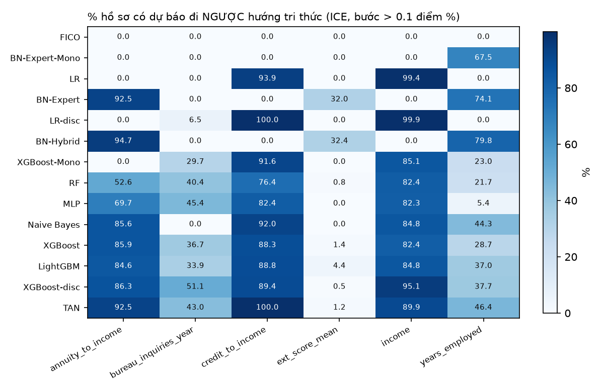
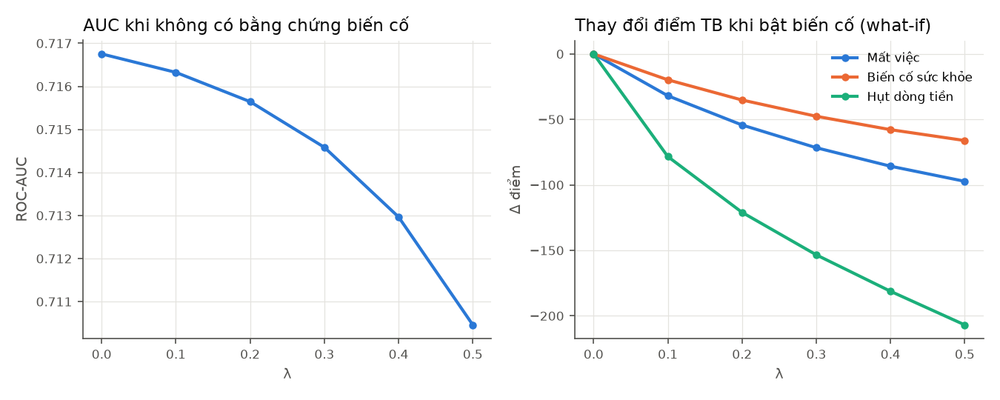
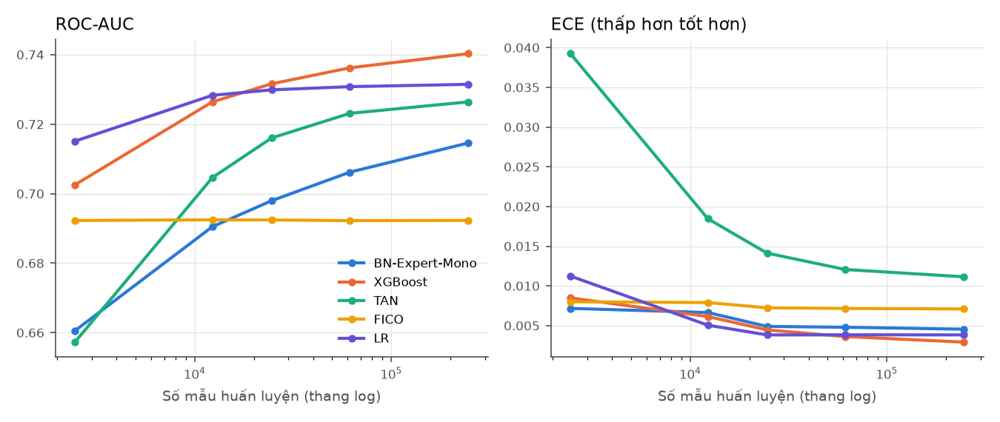
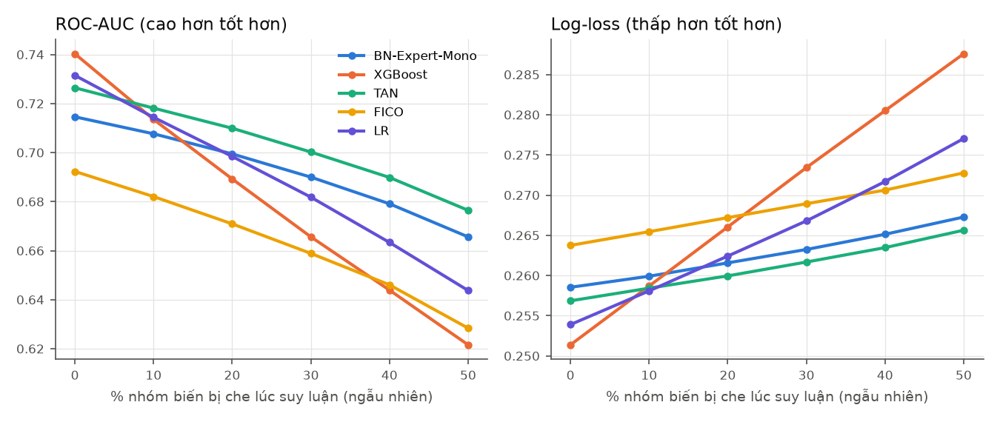
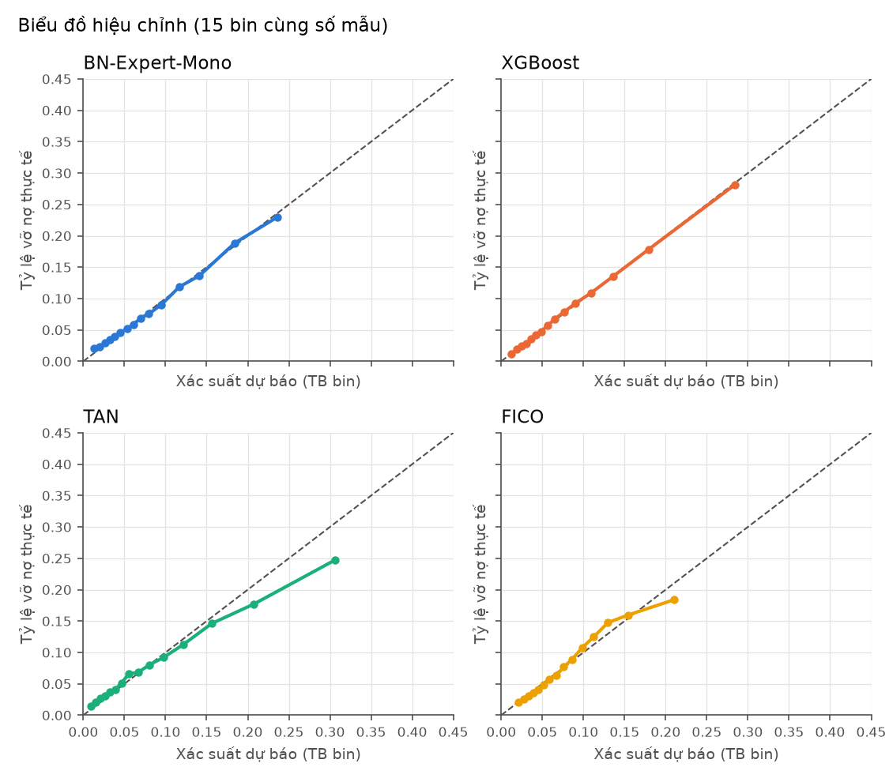
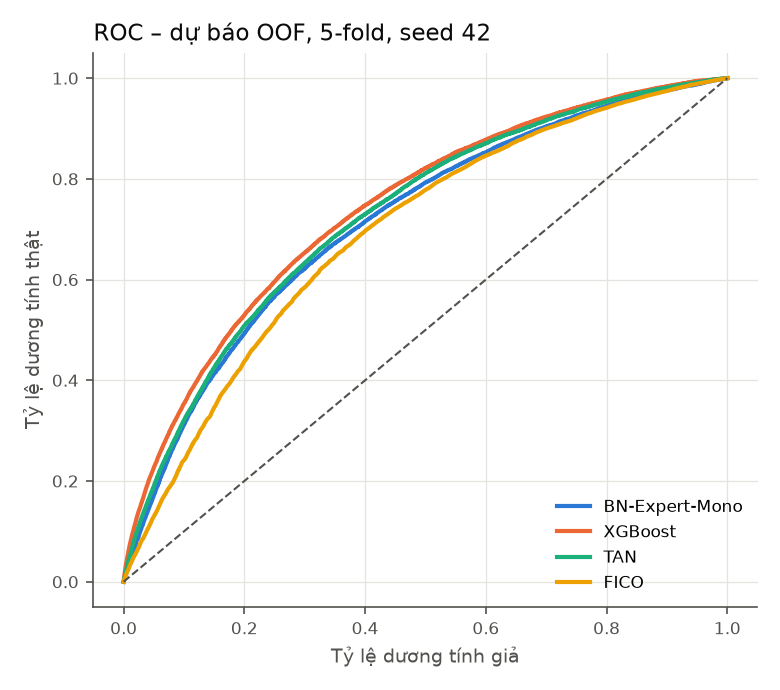
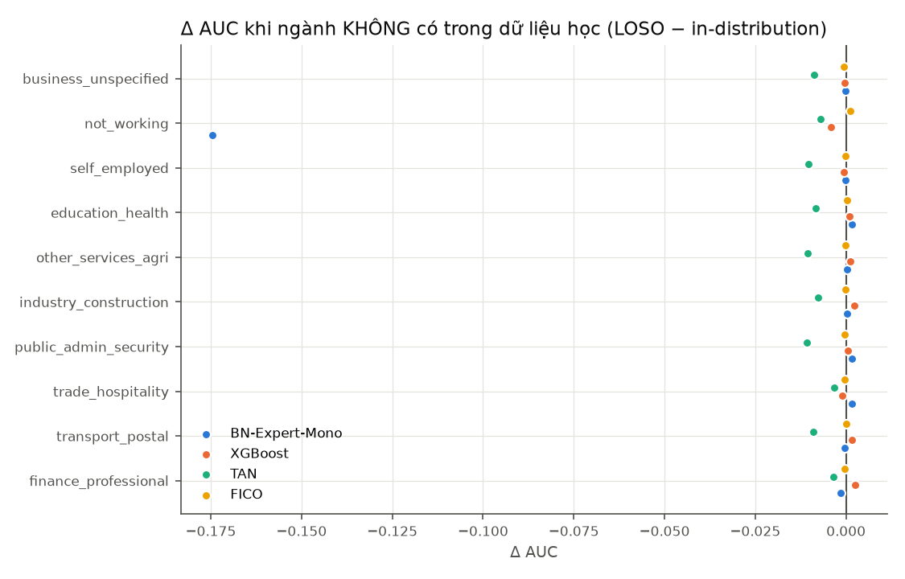
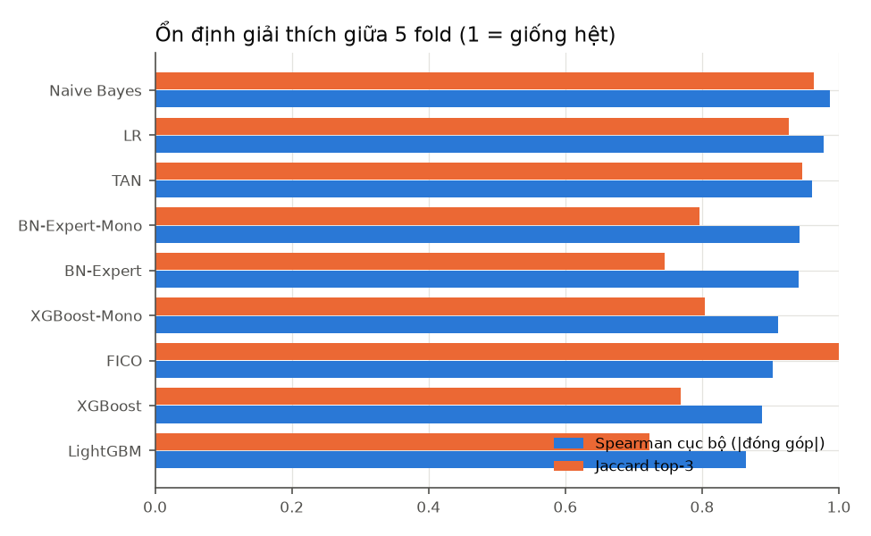

# Tổng hợp kết quả thực nghiệm

_Sinh tự động bởi `python -m src.cli eval tables` từ `experiments/*/results.csv`. Không sửa tay._

<!-- sinh tự động bởi `python -m src.cli eval tables` – không sửa tay -->
**Bảng 1 – Phân biệt & hiệu chỉnh (thí nghiệm 1, 2)**

| Mô hình        | Họ   | Đầu vào   | ROC-AUC         | PR-AUC          |   Gini |    KS | Brier             | Log-loss        | ECE             |   Số lần |
|:---------------|:-----|:----------|:----------------|:----------------|-------:|------:|:------------------|:----------------|:----------------|---------:|
| XGBoost        | ml   | cont      | 0.7404 ± 0.0039 | 0.2172 ± 0.0051 |  0.481 | 0.357 | 0.06899 ± 0.00022 | 0.2513 ± 0.0010 | 0.0031 ± 0.0008 |       15 |
| LightGBM       | ml   | cont      | 0.7392 ± 0.0039 | 0.2161 ± 0.0054 |  0.478 | 0.355 | 0.06906 ± 0.00023 | 0.2517 ± 0.0010 | 0.0031 ± 0.0009 |       15 |
| XGBoost-Mono   | ml   | cont      | 0.7387 ± 0.0042 | 0.2151 ± 0.0049 |  0.477 | 0.354 | 0.06909 ± 0.00023 | 0.2518 ± 0.0011 | 0.0035 ± 0.0011 |       15 |
| RF             | ml   | cont      | 0.7333 ± 0.0041 | 0.2094 ± 0.0040 |  0.467 | 0.348 | 0.06948 ± 0.00016 | 0.2537 ± 0.0008 | 0.0074 ± 0.0011 |       15 |
| MLP            | ml   | cont      | 0.7333 ± 0.0039 | 0.2098 ± 0.0046 |  0.467 | 0.346 | 0.06938 ± 0.00021 | 0.2534 ± 0.0010 | 0.0050 ± 0.0022 |       15 |
| LR             | ml   | cont      | 0.7314 ± 0.0043 | 0.2050 ± 0.0039 |  0.463 | 0.345 | 0.06954 ± 0.00021 | 0.2539 ± 0.0010 | 0.0038 ± 0.0009 |       15 |
| XGBoost-disc   | ml   | disc      | 0.7308 ± 0.0041 | 0.1925 ± 0.0043 |  0.462 | 0.346 | 0.06990 ± 0.00020 | 0.2547 ± 0.0010 | 0.0035 ± 0.0009 |       15 |
| LR-disc        | ml   | disc      | 0.7272 ± 0.0042 | 0.1882 ± 0.0037 |  0.454 | 0.342 | 0.07005 ± 0.00019 | 0.2556 ± 0.0010 | 0.0033 ± 0.0006 |       15 |
| TAN            | bn   | disc      | 0.7265 ± 0.0038 | 0.1896 ± 0.0039 |  0.453 | 0.338 | 0.07040 ± 0.00024 | 0.2568 ± 0.0011 | 0.0111 ± 0.0013 |       15 |
| BN-Expert-Mono | bn   | disc      | 0.7146 ± 0.0043 | 0.1767 ± 0.0039 |  0.429 | 0.326 | 0.07054 ± 0.00020 | 0.2586 ± 0.0010 | 0.0047 ± 0.0008 |       15 |
| BN-Hybrid      | bn   | disc      | 0.7119 ± 0.0047 | 0.1747 ± 0.0039 |  0.424 | 0.322 | 0.07065 ± 0.00020 | 0.2591 ± 0.0011 | 0.0043 ± 0.0008 |       15 |
| BN-Expert      | bn   | disc      | 0.7107 ± 0.0046 | 0.1743 ± 0.0038 |  0.421 | 0.32  | 0.07069 ± 0.00020 | 0.2595 ± 0.0011 | 0.0050 ± 0.0010 |       15 |
| Naive Bayes    | bn   | disc      | 0.7085 ± 0.0042 | 0.1749 ± 0.0037 |  0.417 | 0.312 | 0.07494 ± 0.00046 | 0.2727 ± 0.0019 | 0.0370 ± 0.0016 |       15 |
| BN-Learned     | bn   | disc      | 0.7078 ± 0.0070 | 0.1589 ± 0.0049 |  0.416 | 0.325 | 0.07078 ± 0.00020 | 0.2592 ± 0.0012 | 0.0033 ± 0.0006 |       15 |
| FICO           | rule | disc      | 0.6923 ± 0.0041 | 0.1508 ± 0.0032 |  0.385 | 0.299 | 0.07171 ± 0.00015 | 0.2637 ± 0.0008 | 0.0069 ± 0.0008 |       15 |

_Stratified 5-fold × 3 seed (mean ± std trên các fold), Home Credit 307.511 hồ sơ, tỷ lệ vỡ nợ 8,07%. ECE: 15 bin cùng số mẫu._

<!-- sinh tự động bởi `python -m src.cli eval tables` – không sửa tay -->
**Bảng 2 – Kiểm định ý nghĩa thống kê (thí nghiệm 3)**

| Tham chiếu     | So với         |   Δ AUC (ref − mô hình) |   DeLong p (Holm, max 3 seed) |   t-test hiệu chỉnh p (AUC) | Thắng AUC / số cặp fold   | Δ Log-loss [CI 95%]           | Δ ECE [CI 95%]             |
|:---------------|:---------------|------------------------:|------------------------------:|----------------------------:|:--------------------------|:------------------------------|:---------------------------|
| BN-Expert-Mono | FICO           |                  0.0222 |                      2e-121   |                     3.5e-11 | 15/15                     | -0.00521 [-0.00565, -0.00480] | -0.0033 [-0.0046, -0.0018] |
| BN-Expert-Mono | BN-Expert      |                  0.0034 |                      7.7e-27  |                     1.4e-06 | 15/15                     | -0.00081 [-0.00095, -0.00067] | -0.0005 [-0.0011, +0.0002] |
| BN-Expert-Mono | Naive Bayes    |                  0.006  |                      1.2e-09  |                     0.00061 | 15/15                     | -0.01415 [-0.01490, -0.01338] | -0.0338 [-0.0347, -0.0324] |
| BN-Expert-Mono | TAN            |                 -0.0119 |                      7.6e-47  |                     7e-09   | 0/15                      | +0.00168 [+0.00124, +0.00211] | -0.0075 [-0.0085, -0.0064] |
| BN-Expert-Mono | BN-Learned     |                  0.0069 |                      4e-08    |                     0.024   | 14/15                     | -0.00086 [-0.00122, -0.00053] | +0.0017 [+0.0003, +0.0025] |
| BN-Expert-Mono | BN-Hybrid      |                  0.0022 |                      3.6e-07  |                     0.00052 | 15/15                     | -0.00042 [-0.00062, -0.00025] | +0.0005 [-0.0003, +0.0011] |
| BN-Expert-Mono | LR             |                 -0.0169 |                      6.2e-109 |                     1.7e-10 | 0/15                      | +0.00464 [+0.00425, +0.00502] | +0.0006 [-0.0006, +0.0018] |
| BN-Expert-Mono | LR-disc        |                 -0.0127 |                      1.4e-80  |                     1.4e-09 | 0/15                      | +0.00299 [+0.00270, +0.00326] | +0.0019 [+0.0004, +0.0025] |
| BN-Expert-Mono | XGBoost        |                 -0.0258 |                      6.9e-202 |                     3.3e-12 | 0/15                      | +0.00716 [+0.00676, +0.00759] | +0.0020 [+0.0005, +0.0027] |
| BN-Expert-Mono | XGBoost-disc   |                 -0.016  |                      2.3e-109 |                     8.1e-12 | 0/15                      | +0.00380 [+0.00348, +0.00412] | +0.0011 [-0.0001, +0.0022] |
| BN-Expert-Mono | XGBoost-Mono   |                 -0.0241 |                      6.8e-198 |                     3e-12   | 0/15                      | +0.00670 [+0.00632, +0.00711] | +0.0014 [+0.0001, +0.0023] |
| BN-Expert-Mono | LightGBM       |                 -0.0246 |                      2.4e-170 |                     3.8e-12 | 0/15                      | +0.00685 [+0.00645, +0.00728] | +0.0020 [+0.0006, +0.0027] |
| BN-Expert-Mono | RF             |                 -0.0187 |                      4.9e-140 |                     2.2e-11 | 0/15                      | +0.00479 [+0.00446, +0.00512] | -0.0033 [-0.0045, -0.0019] |
| BN-Expert-Mono | MLP            |                 -0.0178 |                      3.2e-99  |                     3.4e-09 | 0/15                      | +0.00511 [+0.00469, +0.00555] | +0.0018 [+0.0005, +0.0026] |
| XGBoost        | FICO           |                  0.048  |                      0        |                     2.1e-17 | 15/15                     | -0.01237 [-0.01297, -0.01184] | -0.0053 [-0.0059, -0.0036] |
| XGBoost        | BN-Expert      |                  0.0292 |                      1.7e-232 |                     1.7e-11 | 15/15                     | -0.00797 [-0.00841, -0.00754] | -0.0025 [-0.0030, -0.0011] |
| XGBoost        | BN-Expert-Mono |                  0.0258 |                      4.4e-202 |                     3.3e-12 | 15/15                     | -0.00716 [-0.00759, -0.00676] | -0.0020 [-0.0027, -0.0005] |
| XGBoost        | Naive Bayes    |                  0.0318 |                      3.1e-236 |                     1.1e-12 | 15/15                     | -0.02131 [-0.02207, -0.02055] | -0.0359 [-0.0363, -0.0341] |
| XGBoost        | TAN            |                  0.0139 |                      4.1e-96  |                     3.2e-11 | 15/15                     | -0.00548 [-0.00588, -0.00509] | -0.0095 [-0.0100, -0.0080] |
| XGBoost        | BN-Learned     |                  0.0327 |                      2.1e-249 |                     1.1e-09 | 15/15                     | -0.00802 [-0.00851, -0.00755] | -0.0003 [-0.0011, +0.0008] |
| XGBoost        | BN-Hybrid      |                  0.028  |                      1.6e-222 |                     1.9e-11 | 15/15                     | -0.00758 [-0.00805, -0.00717] | -0.0015 [-0.0021, -0.0002] |
| XGBoost        | LR             |                  0.0088 |                      7.1e-57  |                     1.3e-10 | 15/15                     | -0.00252 [-0.00279, -0.00227] | -0.0014 [-0.0020, -0.0000] |
| XGBoost        | LR-disc        |                  0.013  |                      1e-103   |                     1.4e-13 | 15/15                     | -0.00417 [-0.00452, -0.00387] | -0.0001 [-0.0009, +0.0006] |
| XGBoost        | XGBoost-disc   |                  0.0098 |                      5.3e-78  |                     3.4e-10 | 15/15                     | -0.00336 [-0.00365, -0.00308] | -0.0009 [-0.0014, +0.0002] |
| XGBoost        | XGBoost-Mono   |                  0.0017 |                      7e-14    |                     0.00012 | 15/15                     | -0.00046 [-0.00056, -0.00036] | -0.0006 [-0.0010, +0.0003] |
| XGBoost        | LightGBM       |                  0.0012 |                      0.00047  |                     0.003   | 15/15                     | -0.00031 [-0.00041, -0.00020] | -0.0001 [-0.0006, +0.0007] |
| XGBoost        | RF             |                  0.0071 |                      1.1e-47  |                     6.7e-10 | 15/15                     | -0.00237 [-0.00263, -0.00214] | -0.0053 [-0.0060, -0.0035] |
| XGBoost        | MLP            |                  0.008  |                      5.9e-38  |                     7.1e-07 | 15/15                     | -0.00205 [-0.00232, -0.00178] | -0.0002 [-0.0009, +0.0008] |

_DeLong trên dự báo OOF gộp của từng seed, hiệu chỉnh Holm trong mỗi tham chiếu; t-test Nadeau–Bengio trên 15 cặp fold; CI 95% của Δ Log-loss/ECE: paired bootstrap 1.000 lần (seed 42). Δ < 0 ở Log-loss/ECE nghĩa là tham chiếu tốt hơn._

<!-- sinh tự động bởi `python -m src.cli eval tables` – không sửa tay -->
**Bảng 3 – Thiếu thông tin lúc suy luận (thí nghiệm 4)**

(a) Che ngẫu nhiên (MCAR) một tỷ lệ nhóm biến đầu vào ở tập test – ROC-AUC trung bình 5 fold

| Mô hình        |     0% |    10% |    20% |    30% |    40% |    50% |   Δ (50% − 0%) |
|:---------------|-------:|-------:|-------:|-------:|-------:|-------:|---------------:|
| Naive Bayes    | 0.7085 | 0.7025 | 0.6963 | 0.6886 | 0.6802 | 0.6691 |        -0.0395 |
| BN-Expert      | 0.7111 | 0.7056 | 0.6981 | 0.6894 | 0.6793 | 0.6663 |        -0.0448 |
| BN-Expert-Mono | 0.7146 | 0.7077 | 0.6995 | 0.69   | 0.6791 | 0.6656 |        -0.049  |
| TAN            | 0.7264 | 0.7181 | 0.7099 | 0.7002 | 0.6899 | 0.6765 |        -0.05   |
| FICO           | 0.6923 | 0.682  | 0.6709 | 0.6589 | 0.646  | 0.6284 |        -0.0639 |
| XGBoost-disc   | 0.7306 | 0.7185 | 0.7063 | 0.6934 | 0.6796 | 0.6633 |        -0.0673 |
| RF             | 0.7333 | 0.7206 | 0.7077 | 0.6948 | 0.6791 | 0.6612 |        -0.0721 |
| LR-disc        | 0.7273 | 0.7138 | 0.7004 | 0.6863 | 0.6703 | 0.6509 |        -0.0764 |
| MLP            | 0.7324 | 0.7164 | 0.7014 | 0.6848 | 0.6669 | 0.6474 |        -0.0851 |
| LR             | 0.7315 | 0.7144 | 0.6984 | 0.6818 | 0.6633 | 0.6437 |        -0.0877 |
| LightGBM       | 0.7391 | 0.7163 | 0.6936 | 0.6724 | 0.6501 | 0.6283 |        -0.1108 |
| XGBoost        | 0.7403 | 0.7135 | 0.6892 | 0.6656 | 0.6439 | 0.6216 |        -0.1187 |

(b) Kịch bản thiếu có cấu trúc: `no_ext_score` = không có điểm tín dụng ngoài; `no_credit_history` = thêm không có số lần tra cứu; `thin_file` = khách hàng mới: chỉ biết nhân khẩu, ngành/nghề, thu nhập, thâm niên (không có lịch sử tín dụng, khoản vay, tài sản). LL = Log-loss.

| Mô hình        |   Đầy đủ AUC |   no_ext_score AUC |   no_ext_score LL |   no_credit_history AUC |   no_credit_history LL |   thin_file AUC |   thin_file LL |
|:---------------|-------------:|-------------------:|------------------:|------------------------:|-----------------------:|----------------:|---------------:|
| TAN            |       0.7264 |             0.6511 |            0.2698 |                  0.6488 |                 0.27   |          0.6411 |         0.2713 |
| RF             |       0.7333 |             0.6457 |            0.2749 |                  0.644  |                 0.2748 |          0.6361 |         0.2742 |
| Naive Bayes    |       0.7085 |             0.6385 |            0.2787 |                  0.636  |                 0.2787 |          0.6324 |         0.2793 |
| XGBoost-disc   |       0.7306 |             0.641  |            0.2753 |                  0.6395 |                 0.2764 |          0.6313 |         0.2775 |
| LR-disc        |       0.7273 |             0.6363 |            0.2727 |                  0.6336 |                 0.2729 |          0.6271 |         0.2858 |
| LR             |       0.7315 |             0.6336 |            0.2763 |                  0.6331 |                 0.2766 |          0.6238 |         0.2764 |
| BN-Expert      |       0.7111 |             0.6229 |            0.2735 |                  0.62   |                 0.2738 |          0.6211 |         0.2737 |
| BN-Expert-Mono |       0.7146 |             0.622  |            0.2736 |                  0.6191 |                 0.2739 |          0.6199 |         0.2739 |
| MLP            |       0.7324 |             0.6276 |            0.2762 |                  0.6288 |                 0.2761 |          0.6184 |         0.2761 |
| LightGBM       |       0.7391 |             0.6436 |            0.2715 |                  0.641  |                 0.2717 |          0.5962 |         0.2866 |
| XGBoost        |       0.7403 |             0.6504 |            0.2704 |                  0.6481 |                 0.2708 |          0.5935 |         0.292  |
| FICO           |       0.6923 |             0.5529 |            0.2814 |                  0.5473 |                 0.2815 |          0.5786 |         0.279  |

_Mô hình được học trên dữ liệu ĐẦY ĐỦ; chỉ che lúc suy luận. BN/FICO bỏ qua biến thiếu (BN lấy biên chính xác, FICO dùng điểm 'missing'); ML liên tục: XGBoost/LightGBM dùng nhánh mặc định cho NaN, LR/RF/MLP điền trung vị train; ML rời rạc: one-hot toàn 0._

<!-- sinh tự động bởi `python -m src.cli eval tables` – không sửa tay -->
**Bảng 4 – Dữ liệu ít (thí nghiệm 5)**

(a) Home Credit – ROC-AUC theo cỡ tập học (5 fold, seed 42; test luôn là fold đầy đủ)

| model          |   1% (n≈2,460) |   5% (n≈12,300) |   10% (n≈24,601) |   25% (n≈61,502) |   100% (n≈246,008) |
|:---------------|---------------:|----------------:|-----------------:|-----------------:|-------------------:|
| LR             |         0.7151 |          0.7283 |           0.7299 |           0.7308 |             0.7315 |
| LightGBM       |         0.7115 |          0.7182 |           0.7264 |           0.7342 |             0.7391 |
| XGBoost        |         0.7026 |          0.7264 |           0.7316 |           0.7362 |             0.7403 |
| Naive Bayes    |         0.7012 |          0.705  |           0.7049 |           0.7085 |             0.7085 |
| LR-disc        |         0.7    |          0.7203 |           0.7237 |           0.7259 |             0.7273 |
| FICO           |         0.6923 |          0.6925 |           0.6924 |           0.6922 |             0.6923 |
| BN-Expert-Mono |         0.6606 |          0.6905 |           0.698  |           0.7062 |             0.7146 |
| TAN            |         0.6573 |          0.7046 |           0.716  |           0.7231 |             0.7264 |
| BN-Expert      |         0.6145 |          0.661  |           0.6771 |           0.6949 |             0.7111 |
| XGBoost-disc   |         0.5032 |          0.7206 |           0.7237 |           0.7268 |             0.7306 |

(b) Home Credit – ECE theo cỡ tập học

| model          |   1% (n≈2,460) |   5% (n≈12,300) |   10% (n≈24,601) |   25% (n≈61,502) |   100% (n≈246,008) |
|:---------------|---------------:|----------------:|-----------------:|-----------------:|-------------------:|
| LightGBM       |         0.007  |          0.0082 |           0.0046 |           0.0044 |             0.0028 |
| BN-Expert-Mono |         0.0072 |          0.0066 |           0.0049 |           0.0048 |             0.0046 |
| FICO           |         0.008  |          0.0079 |           0.0072 |           0.0072 |             0.0071 |
| XGBoost-disc   |         0.0082 |          0.0067 |           0.005  |           0.0039 |             0.0034 |
| XGBoost        |         0.0085 |          0.0061 |           0.0045 |           0.0036 |             0.0029 |
| BN-Expert      |         0.0094 |          0.0086 |           0.0085 |           0.0064 |             0.0051 |
| LR             |         0.0112 |          0.0051 |           0.0038 |           0.0038 |             0.0038 |
| LR-disc        |         0.0166 |          0.005  |           0.0039 |           0.0036 |             0.0031 |
| TAN            |         0.0392 |          0.0185 |           0.0141 |           0.0121 |             0.0111 |
| Naive Bayes    |         0.0395 |          0.0375 |           0.0397 |           0.0372 |             0.0368 |

(c) German Credit (1.000 hồ sơ, 10 lần × 5-fold) – BN chuyên gia nhỏ (`configs/german_bn.yaml`)

| Mô hình     | AUC n=200     |   LL n=200 | AUC n=400     |   LL n=400 | AUC n=800     |   LL n=800 |
|:------------|:--------------|-----------:|:--------------|-----------:|:--------------|-----------:|
| BN-Expert   | 0.663 ± 0.041 |      0.584 | 0.705 ± 0.038 |      0.568 | 0.731 ± 0.038 |      0.551 |
| Naive Bayes | 0.754 ± 0.038 |      0.563 | 0.768 ± 0.031 |      0.547 | 0.778 ± 0.030 |      0.529 |
| TAN         | 0.697 ± 0.042 |      0.62  | 0.735 ± 0.029 |      0.57  | 0.759 ± 0.034 |      0.539 |
| LR          | 0.755 ± 0.039 |      0.557 | 0.763 ± 0.032 |      0.538 | 0.786 ± 0.033 |      0.504 |
| XGBoost     | 0.743 ± 0.039 |      0.597 | 0.762 ± 0.035 |      0.547 | 0.791 ± 0.032 |      0.5   |
| RF          | 0.764 ± 0.039 |      0.53  | 0.778 ± 0.033 |      0.516 | 0.796 ± 0.031 |      0.502 |

<!-- sinh tự động bởi `python -m src.cli eval tables` – không sửa tay -->
**Bảng 5b – Chẩn đoán XGBoost-disc khi ít dữ liệu (5 fold, seed 42)**

|   fraction | input   | variant              |    auc |   best_iter |   split_nodes |   feasible_cols |   n_features |
|-----------:|:--------|:---------------------|-------:|------------:|--------------:|----------------:|-------------:|
|       0.01 | disc    | as_is (tuned, ES)    | 0.5032 |         184 |           267 |              19 |           64 |
|       0.01 | disc    | H1: tuned, no ES     | 0.5046 |         499 |           463 |              19 |           64 |
|       0.01 | disc    | H2: tuned, mcw=1, ES | 0.7017 |         106 |          3774 |              64 |           64 |
|       0.01 | disc    | untuned (mcw=10), ES | 0.7065 |          74 |          1178 |              57 |           64 |
|       0.01 | cont    | as_is (tuned, ES)    | 0.7026 |         163 |           264 |             nan |           30 |
|       0.01 | cont    | H1: tuned, no ES     | 0.6992 |         499 |           500 |             nan |           30 |
|       0.01 | cont    | H2: tuned, mcw=1, ES | 0.7086 |         113 |          3776 |             nan |           30 |
|       0.01 | cont    | untuned (mcw=10), ES | 0.7125 |          39 |          1068 |             nan |           30 |
|       0.05 | disc    | as_is (tuned, ES)    | 0.7206 |         175 |          1911 |              59 |           65 |
|       0.05 | disc    | H1: tuned, no ES     | 0.7186 |         499 |          3408 |              59 |           65 |
|       0.05 | disc    | H2: tuned, mcw=1, ES | 0.7164 |         110 |          5541 |              64 |           65 |
|       0.05 | disc    | untuned (mcw=10), ES | 0.7143 |          40 |          2278 |              64 |           65 |
|       0.05 | cont    | as_is (tuned, ES)    | 0.7264 |         190 |          2286 |             nan |           30 |
|       0.05 | cont    | H1: tuned, no ES     | 0.7233 |         499 |          3864 |             nan |           30 |
|       0.05 | cont    | H2: tuned, mcw=1, ES | 0.7231 |         143 |          6001 |             nan |           30 |
|       0.05 | cont    | untuned (mcw=10), ES | 0.7234 |          48 |          2368 |             nan |           30 |

_ES = early stopping (100 vòng, val nội bộ 10% train); no ES = 500 cây cố định; mcw = min_child_weight (ngưỡng TỔNG hessian mỗi lá). best_iter, split_nodes: trung vị qua 5 fold; feasible_cols: số cột one-hot mà cả hai nhánh đạt tổng hessian ≥ mcw tại tỷ lệ nền. Chỉ để chẩn đoán – bảng learning curve chính thức giữ nguyên._

<!-- sinh tự động bởi `python -m src.cli eval tables` – không sửa tay -->
**Bảng 5 – Dịch chuyển theo ngành: leave-one-sector-out (thí nghiệm 6)**

| Mô hình        |   AUC in-dist |   AUC LOSO |   Δ AUC TB |   Δ AUC tệ nhất |   Δ Log-loss TB |   ECE LOSO |   |p̄ − y̅| LOSO |   |p̄ − y̅| in-dist |   Δ AUC TB (trừ not_working) |   |p̄ − y̅| LOSO (trừ not_working) |
|:---------------|--------------:|-----------:|-----------:|----------------:|----------------:|-----------:|---------------:|------------------:|-----------------------------:|---------------------------------:|
| XGBoost        |        0.735  |     0.7353 |     0.0003 |         -0.0041 |          0.0003 |     0.0081 |         0.0052 |            0.0005 |                       0.0008 |                           0.0044 |
| LightGBM       |        0.7338 |     0.7338 |     0      |         -0.0132 |          0.0003 |     0.0081 |         0.0054 |            0.0012 |                       0.0015 |                           0.0046 |
| FICO           |        0.6875 |     0.6875 |    -0.0001 |         -0.0007 |          0.0002 |     0.0155 |         0.0122 |            0.011  |                      -0.0002 |                           0.0122 |
| XGBoost-Mono   |        0.7335 |     0.7334 |    -0.0001 |         -0.0036 |          0.0004 |     0.0082 |         0.005  |            0.0007 |                       0.0003 |                           0.0044 |
| LR             |        0.7257 |     0.7254 |    -0.0003 |         -0.0014 |          0.0029 |     0.0172 |         0.0163 |            0.0006 |                      -0.0001 |                           0.0126 |
| Naive Bayes    |        0.7095 |     0.7088 |    -0.0007 |         -0.0037 |          0.5299 |     0.4109 |         0.4109 |            0.0287 |                      -0.0004 |                           0.3771 |
| TAN            |        0.7201 |     0.7121 |    -0.008  |         -0.0108 |          0.5246 |     0.3956 |         0.3956 |            0.0054 |                      -0.0081 |                           0.347  |
| BN-Expert-Mono |        0.7059 |     0.6888 |    -0.0171 |         -0.1745 |          0.0018 |     0.0113 |         0.0085 |            0.0048 |                       0.0004 |                           0.0059 |
| BN-Expert      |        0.7017 |     0.6837 |    -0.018  |         -0.1747 |          0.002  |     0.0118 |         0.0084 |            0.0048 |                      -0.0006 |                           0.0058 |

Δ AUC theo từng ngành (LOSO − in-distribution):

| sector                |   BN-Expert |   BN-Expert-Mono |    FICO |      LR |   LightGBM |   Naive Bayes |     TAN |   XGBoost |   XGBoost-Mono |
|:----------------------|------------:|-----------------:|--------:|--------:|-----------:|--------------:|--------:|----------:|---------------:|
| business_unspecified  |     -0.0035 |          -0.0002 | -0.0007 | -0.0005 |    -0.0007 |       -0.0014 | -0.0088 |   -0.0003 |        -0.0003 |
| education_health      |     -0.0047 |           0.0017 |  0.0003 | -0.0005 |     0.0014 |        0.0001 | -0.0085 |    0.001  |         0.0004 |
| finance_professional  |     -0.0022 |          -0.0016 | -0.0004 | -0.0002 |     0.0044 |       -0.0007 | -0.0035 |    0.0024 |         0.0004 |
| industry_construction |     -0.0004 |           0.0003 | -0.0001 |  0.0001 |     0.0017 |        0.0001 | -0.0078 |    0.0023 |         0.0008 |
| not_working           |     -0.1747 |          -0.1745 |  0.0012 | -0.0014 |    -0.0132 |       -0.0037 | -0.007  |   -0.0041 |        -0.0036 |
| other_services_agri   |      0.0012 |           0.0004 | -0.0002 | -0.0001 |     0.0011 |        0.0001 | -0.0106 |    0.0011 |         0.001  |
| public_admin_security |      0.0046 |           0.0017 | -0.0003 | -0.0001 |     0.002  |       -0.001  | -0.0108 |    0.0006 |        -0.0001 |
| self_employed         |     -0.0009 |          -0      | -0.0002 | -0.0009 |    -0.0005 |       -0.0006 | -0.0103 |   -0.0007 |        -0.0008 |
| trade_hospitality     |      0.0018 |           0.0015 | -0.0003 |  0.0006 |     0.0004 |        0      | -0.0032 |   -0.001  |         0.0004 |
| transport_postal      |     -0.001  |          -0.0004 | -0      |  0.0002 |     0.0032 |        0.0001 | -0.0091 |    0.0015 |         0.0007 |

_LOSO: học trên 9 nhóm ngành, kiểm tra trên nhóm còn lại; in-dist: dự báo OOF (5-fold seed 42) của cùng mô hình trên đúng các hồ sơ đó. |p̄ − y̅| = sai lệch hiệu chỉnh tổng thể._

<!-- sinh tự động bởi `python -m src.cli eval tables` – không sửa tay -->
**Bảng 6 – Nhất quán với tri thức chuyên gia (thí nghiệm 7)**

% hồ sơ có ít nhất một bước ICE đi ngược hướng tri thức (bước > 0,1 điểm %), 5.000 hồ sơ test × 5 fold

| Mô hình        |   annuity_to_income |   bureau_inquiries_year |   credit_to_income |   ext_score_mean |   income |   years_employed |    TB |   PDP đúng hướng (/6) | Biến không tác động (phẳng)                     |
|:---------------|--------------------:|------------------------:|-------------------:|-----------------:|---------:|-----------------:|------:|----------------------:|:------------------------------------------------|
| FICO           |                0    |                    0    |               0    |             0    |     0    |             0    |  0    |                     6 | income, years_employed                          |
| BN-Expert-Mono |                0    |                    0    |               0    |             0    |     0    |            67.53 | 11.26 |                     3 | bureau_inquiries_year, credit_to_income         |
| LR             |                0    |                    0    |              93.94 |             0    |    99.36 |             0    | 32.22 |                     4 | –                                               |
| BN-Expert      |               92.53 |                    0    |               0    |            31.97 |     0    |            74.12 | 33.1  |                     3 | bureau_inquiries_year, credit_to_income         |
| LR-disc        |                0    |                    6.53 |              99.96 |             0    |    99.92 |             0    | 34.4  |                     2 | –                                               |
| BN-Hybrid      |               94.69 |                    0    |               0    |            32.36 |     0    |            79.79 | 34.47 |                     1 | bureau_inquiries_year, credit_to_income, income |
| XGBoost-Mono   |                0    |                   29.73 |              91.6  |             0    |    85.06 |            23.02 | 38.23 |                     2 | –                                               |
| RF             |               52.58 |                   40.44 |              76.37 |             0.84 |    82.44 |            21.7  | 45.73 |                     4 | –                                               |
| MLP            |               69.69 |                   45.44 |              82.42 |             0    |    82.26 |             5.37 | 47.53 |                     2 | –                                               |
| Naive Bayes    |               85.65 |                    0    |              92    |             0    |    84.85 |            44.32 | 51.14 |                     2 | –                                               |
| XGBoost        |               85.89 |                   36.73 |              88.34 |             1.44 |    82.35 |            28.66 | 53.9  |                     1 | –                                               |
| LightGBM       |               84.61 |                   33.94 |              88.82 |             4.35 |    84.8  |            36.97 | 55.58 |                     2 | –                                               |
| XGBoost-disc   |               86.33 |                   51.15 |              89.39 |             0.5  |    95.11 |            37.65 | 60.02 |                     1 | –                                               |
| TAN            |               92.49 |                   42.99 |              99.98 |             1.22 |    89.87 |            46.41 | 62.16 |                     2 | –                                               |

_Hướng kỳ vọng (tăng biến): annuity_to_income: ↑ rủi ro, credit_to_income: ↑ rủi ro, ext_score_mean: ↓ rủi ro, years_employed: ↓ rủi ro, bureau_inquiries_year: ↑ rủi ro, income: ↓ rủi ro. BN-Expert-Mono / XGBoost-Mono bị ràng buộc đơn điệu ở DSTI & ext_score theo thiết kế (0% ở hai cột đó là do xây dựng, không phải phát hiện). 0% ở biến phẳng (≥ 95% hồ sơ không đổi dự báo khi đổi biến) là KHÔNG có tác động – không phải tuân thủ tri thức; với BN đó là do d-separation khi đã biết các nút cha của Vỡ nợ._

<!-- sinh tự động bởi `python -m src.cli eval tables` – không sửa tay -->
**Bảng 7 – Ổn định giải thích giữa các fold (thí nghiệm 8)**

| Mô hình        |   Spearman cục bộ |   Jaccard top-3 |   Đồng dấu top-3 |   Spearman toàn cục |   MAD đóng góp (log-odds) |
|:---------------|------------------:|----------------:|-----------------:|--------------------:|--------------------------:|
| Naive Bayes    |            0.9873 |          0.9639 |           1      |              0.9879 |                    0.0081 |
| LR             |            0.9776 |          0.9264 |           1      |              0.9791 |                    0.0052 |
| TAN            |            0.9602 |          0.9459 |           1      |              0.9978 |                    0.0249 |
| BN-Expert-Mono |            0.9429 |          0.7955 |           0.9748 |              0.9978 |                    0.0292 |
| BN-Expert      |            0.9407 |          0.745  |           0.9563 |              0.9978 |                    0.0412 |
| XGBoost-Mono   |            0.9109 |          0.8046 |           0.9999 |              0.9813 |                    0.0194 |
| FICO           |            0.9032 |          0.9994 |           0.9999 |              0.8989 |                    0.001  |
| XGBoost        |            0.8878 |          0.769  |           0.999  |              0.9857 |                    0.0227 |
| LightGBM       |            0.8641 |          0.7236 |           0.9984 |              0.9802 |                    0.0248 |

Top-5 nhóm biến quan trọng nhất (TB |đóng góp| trên 2.000 hồ sơ, 5 fold):

| Mô hình        | Top-5                                                                                 |
|:---------------|:--------------------------------------------------------------------------------------|
| BN-Expert      | ext_score_mean, occupation_group, years_employed, annuity_to_income, region_rating    |
| BN-Expert-Mono | ext_score_mean, occupation_group, years_employed, annuity_to_income, income           |
| FICO           | ext_score_mean, age_years, annuity_to_income, credit_to_income, bureau_inquiries_year |
| LR             | ext_score_mean, years_employed, education, annuity_to_income, assets                  |
| LightGBM       | ext_score_mean, years_employed, education, occupation_group, age_years                |
| Naive Bayes    | ext_score_mean, years_employed, occupation_group, age_years, sector                   |
| TAN            | sector, years_employed, ext_score_mean, occupation_group, credit_to_income            |
| XGBoost        | ext_score_mean, years_employed, education, age_years, occupation_group                |
| XGBoost-Mono   | ext_score_mean, annuity_to_income, years_employed, education, age_years               |

Tương quan hạng độ quan trọng toàn cục BN-Expert-Mono vs XGBoost (SHAP): ρ = 0.29.

_Cùng 2.000 hồ sơ cố định, giải thích bởi 5 mô hình học trên 5 fold khác nhau; trung bình trên 10 cặp fold. BN/FICO: đóng góp so với mức phổ biến của quần thể (suy luận chính xác); cây: TreeSHAP; LR: SHAP tuyến tính._

<!-- sinh tự động bởi `python -m src.cli eval tables` – không sửa tay -->
**Bảng 8 – Chi phí tính toán (thí nghiệm 9)**

| Mô hình        | Họ   |   Thời gian học (s) |   Suy luận / 10k hồ sơ (s) |   Số tham số |   Kích thước (KB) |
|:---------------|:-----|--------------------:|---------------------------:|-------------:|------------------:|
| FICO           | rule |               0.602 |                      0.012 |       31     |             2.622 |
| Naive Bayes    | bn   |               0.687 |                      0.034 |      103     |             3.709 |
| BN-Expert      | bn   |               1.035 |                      0.042 |     6989     |           115.926 |
| LR             | ml   |               1.166 |                      0.017 |       31     |             5.381 |
| LR-disc        | ml   |               1.622 |                      0.031 |       67     |             5.122 |
| BN-Hybrid      | bn   |               1.78  |                      0.033 |     4933.07  |            82.992 |
| BN-Learned     | bn   |               2.975 |                      0.033 |      650.667 |            10.599 |
| LightGBM       | ml   |               3.105 |                      0.034 |    23939.1   |           916.91  |
| BN-Expert-Mono | bn   |               5.534 |                      0.044 |     6989     |           115.936 |
| TAN            | bn   |               8.559 |                      0.043 |      519     |             9.127 |
| MLP            | ml   |               9.949 |                      0.021 |     4097     |           108.088 |
| XGBoost-Mono   | ml   |              10.656 |                      0.035 |    42629.7   |          1384.32  |
| XGBoost-disc   | ml   |              10.908 |                      0.047 |    46547.7   |          1476.67  |
| XGBoost        | ml   |              12.954 |                      0.039 |    49073.3   |          1602.25  |
| RF             | ml   |              14.955 |                      0.049 |   381185     |         29865.2   |

_Trung bình trên các fold, ~246k hồ sơ học, CPU 16 luồng. Kích thước = pickle của mô hình đã học (gồm cả tiền xử lý). Số tham số: BN Σ(r−1)·q; cây: số nút; LR: hệ số._

<!-- sinh tự động bởi `python -m src.cli eval tables` – không sửa tay -->
**Bảng 9 – Độ nhạy tham số giả định λ của lớp tri thức (BN-Expert-Mono)**

|   lambda |    AUC |   Log-loss |    ECE |   Δ điểm: mất việc |   Δ điểm: sức khỏe |   Δ điểm: hụt dòng tiền |   Δ điểm: suy thoái |   Δ điểm: lạm phát cao |   Ô p0 bị cắt |
|---------:|-------:|-----------:|-------:|-------------------:|-------------------:|------------------------:|--------------------:|-----------------------:|--------------:|
|      0   | 0.7168 |     0.258  | 0.0041 |             0      |             0      |                   0     |              0      |                 0      |           0   |
|      0.1 | 0.7163 |     0.2581 | 0.0041 |           -31.9455 |           -19.7757 |                 -78.381 |             -0.2075 |                -1.6323 |           0.2 |
|      0.2 | 0.7156 |     0.2583 | 0.0043 |           -54.2844 |           -35.1983 |                -120.996 |             -0.4173 |                -3.2629 |           9.8 |
|      0.3 | 0.7146 |     0.2585 | 0.0046 |           -71.6379 |           -47.624  |                -153.434 |             -0.6168 |                -4.7368 |          38   |
|      0.4 | 0.713  |     0.2588 | 0.0048 |           -85.7473 |           -57.8472 |                -181.262 |             -0.7994 |                -6.0328 |         111   |
|      0.5 | 0.7105 |     0.2593 | 0.005  |           -97.2889 |           -66.1411 |                -206.926 |             -0.9547 |                -7.0997 |         194.4 |

_AUC/Log-loss/ECE: dự báo khi KHÔNG có bằng chứng biến cố (đúng như dữ liệu). Δ điểm: thay đổi điểm 300–850 trung bình của 2.000 hồ sơ đang đi làm khi bật biến cố (what-if), 5 fold._

<!-- sinh tự động bởi `python -m src.cli eval tables` – không sửa tay -->
**Bảng 10 – Độ trung thành của lời khuyên LLM (kiểm tra tự động)**

| provider           |   number_precision |   fact_coverage |   direction_ok |   faithful |   latency_s |   n |   n_so_ngoai_du_kien |   n_sai_huong |
|:-------------------|-------------------:|----------------:|---------------:|-----------:|------------:|----:|---------------------:|--------------:|
| groq:gpt-oss-120b  |              0.989 |           0.993 |           0.98 |       0.72 |       2.044 |  50 |                   12 |             1 |
| groq:qwen3.8-27b   |              1     |           0.993 |           0.96 |       0.94 |      14.646 |  50 |                    0 |             2 |
| template           |              1     |           1     |           1    |       1    |       0     |  50 |                    0 |             0 |
| template_corrupted |              0.959 |           0.823 |           0.04 |       0    |       0     |  50 |                   48 |            48 |

_number_precision: tỷ lệ con số trong lời khuyên có trong dữ kiện BN cung cấp; fact_coverage: tỷ lệ dữ kiện bắt buộc được nhắc; direction_ok: không nói sai hướng tác động; faithful: đạt cả ba. n_so_ngoai_du_kien / n_sai_huong: số lời khuyên có ≥ 1 con số không có trong dữ kiện / nói sai hướng. template_corrupted: đối chứng âm (cố ý sửa sai). latency_s (giây) gồm cả thời gian chờ khi bị giới hạn tốc độ (HTTP 429) của gói miễn phí → không dùng để so tốc độ model._

## Hình

